<!--
Master document for the technical report. Compiled to report.pdf by build_report.py
(pandoc -> standalone HTML with report.css -> Microsoft Edge headless print-to-pdf).
Traceability rule (AGENTS.md): every number in this report cites an EXP id that exists
in results/experiments_log.csv, or a named committed artifact in results/ (EDA notes,
statistical-comparison note, error-analysis note, per-phase summaries). If a number is
not logged, it is not written. Status: final draft v1.0.
-->

# Predicting Fair/Poor Self-Rated Health from BRFSS 2021: A Binary Classification Study

- **Author:** Hassene Bouamama
- **Course:** Machine Learning final project — University of Alicante (C2 call, due 2026-11-08)
- **Date:** 2026-11-02
- **Recommended model:** tuned LightGBM — mean CV ROC-AUC **0.9043** (EXP-014a), nested-CV-confirmed **0.9043** (EXP-015)
- **Report status: final draft v1.0**

> **Traceability.** All 42 experiment rows live in the append-only log `results/experiments_log.csv`; every number below cites its row (e.g. EXP-014a). Each row was produced under the identical stratified 10-fold split — `StratifiedKFold(10, shuffle=True, random_state=42)`, fold-index SHA `3b3a17457039`, asserted per run. Descriptive analyses that fit no model (EDA, Wilcoxon tests, error analysis, SHAP) carry no log row by design; they cite their committed artifacts, whose provenance is documented in `results/p7/oof_provenance.json`.

## 1. Introduction & dataset

The Behavioral Risk Factor Surveillance System (BRFSS) is the CDC's premier system of health-related telephone surveys. It collects state-level data on U.S. residents' health-related risk behaviors, chronic conditions, and use of preventive services across all 50 states, the District of Columbia, and three territories — more than 400,000 adult interviews per year (course guidelines, §1).

This project uses the BRFSS 2021 LLCP public file: **438,693 respondent records × 303 columns**, all numeric-encoded (EXP-000). The analysis target is `GENHLTH`, the five-level self-rated health item.

Self-rated general health is a meaningful prediction target: it is one of the most widely used summary indicators in survey epidemiology, and the CDC itself publishes an official derived indicator from it. Predicting it from behavioral, functional, and socio-demographic factors is a technically demanding instance of learning from wide, noisy, sentinel-coded survey data.

The dataset poses four documented challenges, all confirmed empirically in EXP-000:

1. **High dimensionality with heavy missingness.** 92 of 303 columns exceed 90% blank+sentinel; 155 exceed 50%; 3 are completely empty; 247 contain at least one sentinel code (EXP-000).
2. **Sentinel-coded missingness.** Don't-know/refused values (7/77/777, 9/99/999, and 6-digit variants) and codebook-specific "none" codes (88) are stored as ordinary numbers and must be recoded before modeling.
3. **Class imbalance.** Under the chosen binary framing, 16.63% of valid rows are positive (Table 1).
4. **Variables directly related to the target.** Calculated columns derived from `GENHLTH` (notably `_RFHLTH`) would leak the label; they are identified and blacklisted before modeling (EXP-000).

**Table 1 — Target distribution (EXP-000).**

| GENHLTH code | Meaning | n | share of valid |
|---|---|---|---|
| 1 | Excellent | 77,741 | 17.8% |
| 2 | Very good | 149,112 | 34.1% |
| 3 | Good | 137,938 | 31.5% |
| 4 | Fair | 54,736 | 12.5% |
| 5 | Poor | 18,005 | 4.1% |
| 7 / 9 / blank | Don't know / Refused / missing | 788 / 369 / 4 | dropped (1,161 rows) |
| **y = 1 (Fair/Poor)** | {4, 5} | **72,741** | **16.63%** |
| **y = 0 (rest)** | {1, 2, 3} | **364,791** | **83.37%** |

After dropping the 1,161 unusable target rows, **437,532 valid rows** remain, with a 1 : 5.0 positive:negative ratio (EXP-000).

The work addresses every course learning objective:

- managing and preprocessing a complex real-world clinical dataset;
- framing the native multiclass problem as binary classification (ADR-001);
- applying and comparing seven classifier families;
- robust evaluation — identical stratified 10-fold CV everywhere, Wilcoxon testing, nested CV;
- feature engineering, selection and tuning to maximize ROC-AUC.

## 2. Task framing — binary classification per ADR-001

**Target definition (ADR-001).** y = 1 iff `GENHLTH` ∈ {4, 5} (Fair or Poor); y = 0 iff `GENHLTH` ∈ {1, 2, 3}. Rows with `GENHLTH` ∈ {7, 9, blank} are dropped, never imputed (1,161 rows; EXP-000).

The metric is ROC-AUC, and the validation scheme is stratified 10-fold CV on identical folds for every model. The fold SHA `3b3a17457039` is asserted in all 41 model-experiment rows of `results/experiments_log.csv`; EXP-000, the profiling row, has no CV folds by design.

**Why this cut, and why it is not arbitrary.** The CDC itself derives its official "adults with fair or poor health" indicator `_RFHLTH` from `GENHLTH` with exactly this boundary. Our binary target therefore mirrors an established operationalization used in federal reporting rather than a convenience split (ADR-001).

A direct empirical consequence: anything derived from `GENHLTH` is target leakage. The leakage probe confirmed this in the strongest possible terms — `_RFHLTH` agrees with our y on **437,532 of 437,532 valid rows (100.0% agreement, perfectly diagonal crosstab)** (EXP-000). In the 2021 coding, `_RFHLTH` = 2 means Fair/Poor (y = 1); the reversed mapping agrees on zero rows. For contrast, `GENHLTH` itself shows Spearman ρ = +0.672 against y (EXP-000).

The leak columns `GENHLTH`, `_RFHLTH`, `_PHYS14D`, `_MENT14D` were therefore hard-excluded from the feature matrix (ADR-004/ADR-005). The matrix is built by **whitelist**, so a drop-list typo can never leak the target (§3).

A subtler leakage question was resolved with data rather than decree (ADR-004). The Tier-3 "construct-suspicion" block — the health-days items `PHYSHLTH` (ρ = −0.293 pre-recode), `MENTHLTH` (ρ = −0.099), `POORHLTH` (ρ = −0.104, 50.8% coverage) — is strongly associated with the target, but none is *derived* from `GENHLTH`; each measures a distinct construct (days of poor physical/mental health; days of activity limitation).

The contrast case is instructive: `_RFHLTH`'s 100% agreement is what true target derivation looks like; ρ ≈ 0.3 is what a legitimately strong predictor looks like. All three were kept, with `POORHLTH`'s final fate left to empirical feature selection (ADR-004).

**Alternatives considered and rejected (ADR-001):**

- *Poor (5) vs rest* — 4.1% positives (18,005 rows; Table 1): harsher imbalance, noisier fold scores, thin error-analysis pool. Rejected.
- *Keep the native 5-class problem as the main task* — contradicts the course's explicit binary framing and makes the required ROC-AUC/Dummy baseline awkward. Rejected, with the optional multiclass extension explicitly declined in ADR-002 (scope: Basic + Intermediate + Advanced via boosting libraries, automated search, and nested CV instead).
- *Good-or-better vs rest* — identical partition with flipped labels; no distinct experiment.

**Consequences of the framing.** A 16.63% positive rate gives stable stratified folds (~7.3k positives per fold) and a genuinely exercised imbalance question, answered empirically in §6. The ordinal 3|4 boundary being binarized, meanwhile, turns out to be the dominant error mode — analyzed in §9.

## 3. Data cleaning & preprocessing decisions

Preprocessing is governed by one principle from the Leakage watchlist: **the feature matrix is built from an explicit keep-list, never by blacklisting drops** — a typo in a drop-list must not leak the target.

Raw data are immutable. The cleaned matrix is checkpointed once to `data/interim/clean_v1.parquet` (438,693 × 76, sentinels → NaN, engineering recodes applied, no target column) so that no CV fold ever re-cleans (ADR-005).

**Whitelist construction: 303 → 76 columns via seven rules (ADR-005).** Every one of the 303 census columns received an explicit verdict and reason — no silent drops. Rules applied with precedence R1 > R3 > R2 > R6 > R4 > R5 > keep:

- **R1 — leakage blacklist:** `GENHLTH`, `_RFHLTH`, `_PHYS14D`, `_MENT14D`; enforced by a hard assert in preprocessing.
- **R2 — identifiers/admin/weights/telephone-flow:** `SEQNO`, `_PSU`, `_LLCPWT`, `_STSTR`, MSA/landline/cell admin, `NUMHHOL3`, `CPDEMO1B`, `MSCODE`.
- **R3 — census-constant columns:** 11 constants + `IYEAR`.
- **R4 — sparse micro-coverage modules** (>90% blank+sentinel): per ADR-004 this includes the caregiver block CDASSIST/CDHOUSE/CDSOCIAL, whose |ρ| = 0.28–0.32 on ~1% coverage was a selection artifact.
- **R5 — coverage gate:** survival requires ≥25% effective coverage after sentinel recode; 10–25% → module drop. Borderline cases resolved by the rule: `PREDIAB1` 25.98% kept, `PDIABTST` 24.86% dropped, `SOMALE` 25.23% the minimum kept.
- **R6 — duplicate-resolution with keep-raw preference:** e.g. `_BMI5` over the height/weight/BMI-flag family; `_SMOKER3` over `SMOKE100`/`SMOKDAY2`/`_RFSMOK3`; `_AGE80` over age bins; `_RACE` over race groupings; `EDUCA`/`INCOME3`/`PRIMINSR` over their computed bins; `EXERANY2` over `_TOTINDA`; `HAVARTH5` over `_DRDXAR3`; alcohol/tobacco/vaccine raws over computed indices.
- **R7 — recorded judgment calls:** keep `QSTLANG` drop `QSTVER`; keep `_URBSTAT` drop `_METSTAT`; keep `FLSHTMY3` as nominal with 777777/999999 → NaN; keep `CHOLCHK3` as nominal because its codebook order is non-monotone; keep `CHECKUP1` as ordinal with 8 = "never"; keep `_STATE` as a legitimate nominal predictor.

**Table 2 — Column triage outcome (ADR-005; all 303 columns).**

| Verdict | n | Examples / notes |
|---|---|---|
| KEEP-NOM (one-hot) | 54 | chronic-condition items, demographics, module survivors, `_STATE` (53 FIPS), `_RACE`, `QSTLANG`, `_URBSTAT` |
| ENG (engineered numeric) | 15 | PHYSHLTH/MENTHLTH/POORHLTH (88→0), CHILDREN, ALCDAY5→drinks/month, AVEDRNK3/DRNK3GE5, MARIJAN1, 6 fruit-veg items→times/month, `_BMI5`÷100 |
| KEEP-ORD (ordinal) | 4 | CHECKUP1, EDUCA, INCOME3, `_SMOKER3` |
| KEEP-NUM | 3 | JOINPAI2 (0–10), MAXDRNKS, `_AGE80` |
| DROP-SPARSE | 86 | >90% blank+sentinel modules (hepatitis, HPV, shingles, caregiver detail, …) |
| DROP-DUP | 65 | computed duplicates of kept raws (`_TOTINDA`, `_DRDXAR3`, `_RFBMI5`, `_RFDRHV7`, …) |
| DROP-MODULE | 26 | optional modules under the 25% coverage gate |
| DROP-ID | 18 | identifiers, dates, weights, strata |
| DROP-MODE | 16 | interview-mode / telephone-flow admin |
| DROP-CONSTANT | 12 | census-constant columns incl. the 3 empty CFS items |
| DROP-LEAK | 4 | `GENHLTH`, `_RFHLTH`, `_PHYS14D`, `_MENT14D` |
| **Total kept** | **76** | frozen as matrix v1 |

Two duplicate pairs were *proven* identical rather than assumed: `EXERANY2` ≡ `_TOTINDA` (identical pairwise n = 436,659 and identical ρ = 0.2465) and `_DRDXAR3` ≡ `HAVARTH5` (identical n = 434,721, identical ρ = −0.2172) — both in EXP-000.

**Sentinel handling: per-column value contracts, not pattern matching.** The BRFSS codebook's generic 7/9/77/99 scan is a trap, and the census's naive scan both over- and under-counts (ADR-005):

- `EMPLOY1` code 7 = "Retired" (131,546 rows — a valid value; only 9 is a sentinel);
- `INCOME3` and `PRIMINSR` codes 7 and 9 are valid brackets/plans (sentinels are 77/99);
- `IMFVPLA2` 7/9 valid; `JOINPAI2` 7/9 are valid 0–10 pain ratings;
- `_RACE` 7 = Multiracial; `_STATE` 9 = Connecticut; `_AGE80` 77 = age 77 (no sentinels at all);
- 6-digit sentinels 777777/999999 exist in `FLSHTMY3`/`HIVTSTD3`.

Consequently every column has a codebook-exact sentinel set, asserted post-recode; residual-sentinel scans returned zero violations (ADR-005 sanity gates).

**Day-count "none" codes and the sign-flip evidence.** For day-count variables, 88 means *zero days*, not missing: `PHYSHLTH` carries 88 on 287,796 of 438,693 rows (~66%) (EXP-000).

The 88→0 recode is mandatory (ADR-004), and its importance is empirically measurable. On raw codes, `PHYSHLTH`'s Spearman ρ vs y is **−0.293**, because the "none" sentinel dominates the numeric range; after the recode it is **+0.450** — the strongest whitelist feature and ultimately the model's #1 driver (§4, §7, §9) (EXP-000). Treating sentinels as numbers would have handed every model an inverted health signal.

**Missingness after recode and imputation.** Overall matrix missingness is **20.54%** (ADR-005), sharply bimodal: a core-survey mode (median column missingness 5.3%) and an optional-module mode up to 74.8% (`SOMALE`; `PREDIAB1` 74.0%) (`results/analysis/eda_notes.md` §2). Because module assignment is questionnaire design, missingness is structural.

Imputation is therefore conservative and **fold-safe** — always fit on training folds only inside the CV pipeline: most-frequent imputation + one-hot for nominal columns, median for ordinal/numeric/engineered (EXP-001..003 setup).

For the gradient-boosting families a stronger option was verified and adopted (§6): **NaN-passthrough**. The one-hot encoder encodes NaN as its own category (51 of 54 NOM columns carry NaN in matrix v1) and the boosters route NaN natively at split time — missingness stays signal instead of being blurred (EXP-005..007).

All ADR-005 sanity gates passed at matrix build:

- blacklist absent; `EXERANY2` in / `_TOTINDA` out; `HAVARTH5` in / `_DRDXAR3` out;
- 437,532 valid / 72,741 positives / 16.63%;
- zero residual sentinels; all kept columns ≥25% effective coverage.

The 89 codebook-legal `_BMI5` values above 80.0 were kept and flagged (negligible for trees; 88 among non-missing valid rows in EDA).

## 4. Exploratory data analysis

EDA was run on matrix v1 (437,532 valid rows × 76 columns) by the data-analyst (`results/analysis/eda_notes.md`; figures dpi 150). It has no log row by design (analysis, not a model run); every figure was value-re-probed programmatically.

**Target imbalance (Figure 1).** The binary target is 16.63% positive (72,741) vs 83.37% negative (364,791), a 1 : 5.0 ratio. Stratified 10-fold CV puts ~7.3k positives in every fold, so AUC estimation is stable; the 83.4% majority-class accuracy baseline is trivially high, confirming ROC-AUC as the right metric. The figure motivated the explicit imbalance experiments of §6 rather than presuming their answer.

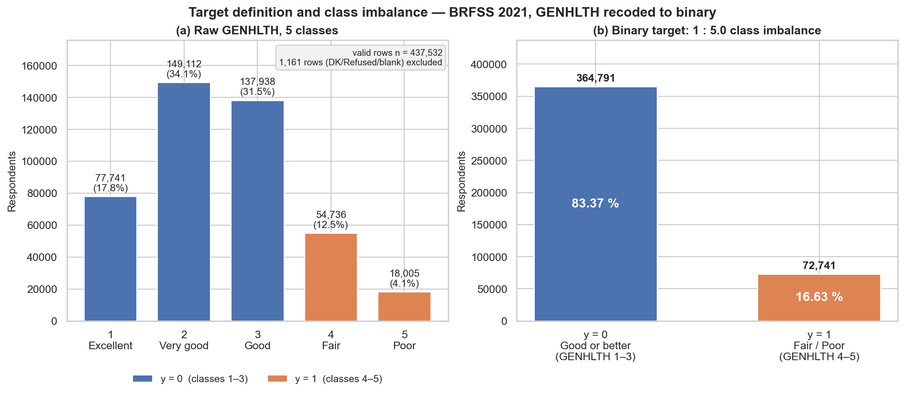

**Missingness (Figure 2).** Per-column missingness is bimodal — core survey (< 15%) vs optional modules (57–75%) — with median 5.3%. Four columns are fully complete (`SEXVAR`, `QSTLANG`, `_STATE`, `_AGE80`); 21 columns are > 25% and 19 > 50% missing.

Two of the strongest single predictors sit in the high-missingness regime (`JOINPAI2` 68.1%, `POORHLTH` 48.0%), so their imputed values deserve extra distrust — a fact that later shaped the NaN-passthrough choice (§6) and the interpretation of case B (§9).

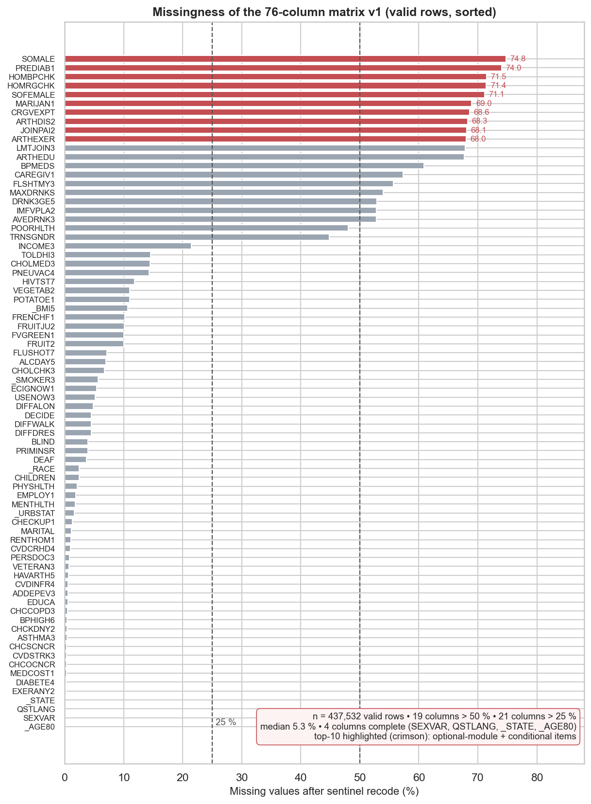

**Univariate associations (Figure 3, Table 3).** Spearman ρ vs y, pairwise-complete, on the 76 whitelist features (no blacklisted column can appear by construction).

**Table 3 — Top-10 whitelist features by |ρ| with y (results/analysis/eda_notes.md §3).**

| # | Feature | ρ | Reading |
|---|---|---|---|
| 1 | PHYSHLTH | **+0.450** | more poor-physical-health days → Fair/Poor (after 88→0; was −0.293 on raw codes, EXP-000) |
| 2 | DIFFWALK | −0.413 | reverse-coded 1/2 item: difficulty walking → Fair/Poor |
| 3 | JOINPAI2 | +0.343 | more joint pain (68.1% missing — module) |
| 4 | DIFFALON | −0.320 | difficulty alone → Fair/Poor |
| 5 | POORHLTH | +0.307 | more activity-limitation days (48.0% missing) |
| 6 | LMTJOIN3 | −0.290 | limited by joints |
| 7 | DIFFDRES | −0.282 | difficulty dressing |
| 8 | INCOME3 | −0.278 | lower income bracket → Fair/Poor |
| 9 | EMPLOY1 | +0.258 | driven by code 8 "unable to work": 2.7% of y=0 vs 21.6% of y=1 |
| 10 | CHCCOPD3 | −0.252 | COPD (reverse-coded) |

The ceiling |ρ| ≈ 0.45 with no leak-like outlier says the target is multi-causal — no single feature separates Fair/Poor, so gains must come from combining feature blocks, which argues for boosted ensembles over single shallow models. It also confirms the leakage controls worked: nothing approaches `_RFHLTH`'s 100% agreement (§2). At the other end, `POTATOE1` (−0.0005), `CRGVEXPT` (−0.001) and `_STATE` (+0.007) are effectively uninformative marginals.

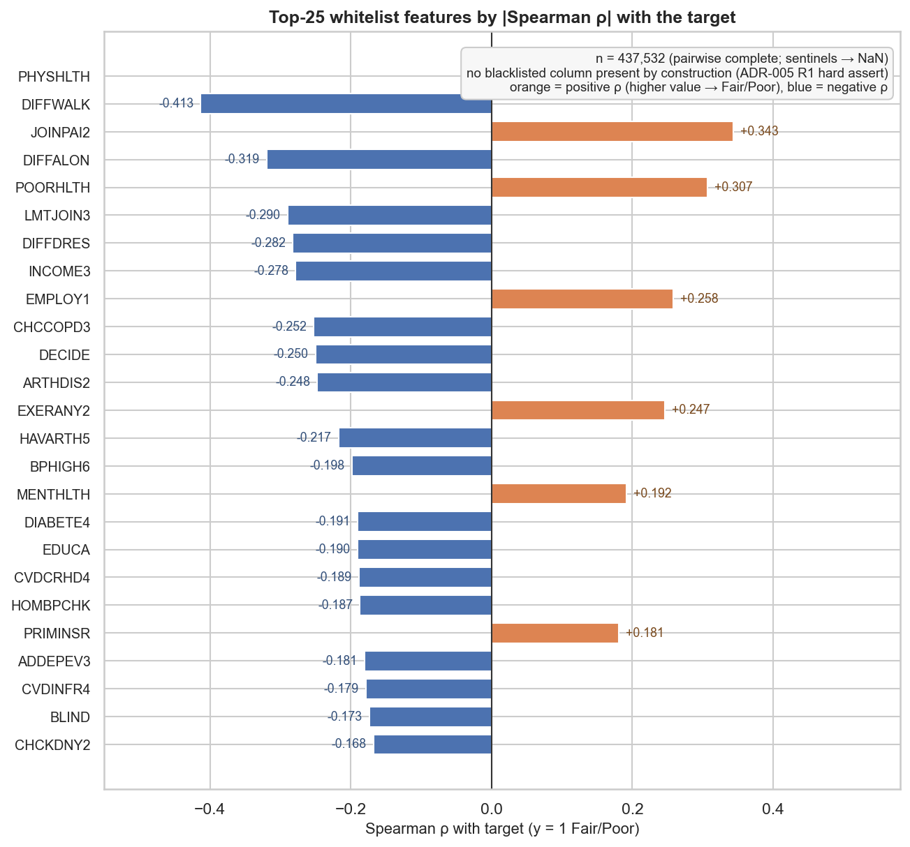

**Correlation structure (Figure 4).** Within the top-40 features shown in the heatmap, the maximum off-diagonal |ρ| is **0.590** (`CHOLMED3`–`TOLDHI3`, cholesterol medication vs ever-told-high-cholesterol). Only 4 pairs exceed 0.5 — also `EMPLOY1`–`_AGE80` 0.562 retirement, `BPHIGH6`–`HOMBPCHK` 0.538, `HOMBPCHK`–`HOMRGCHK` 0.509 — and none exceeds 0.7.

The full 76×76 matrix peaks higher, at |ρ| = **0.744** (`AVEDRNK3`–`MAXDRNKS`, co-asked alcohol items sharing respondents by survey skip-logic). The redundancy is contained by the ADR-005 duplicate-pair resolutions and empirically benign: EXP-012's complement, which holds the alcohol block, adds only ~+0.003 AUC over H1.

Within-block redundancy is moderate (health days ρ +0.234…+0.409; disability items +0.213…+0.432), so tree importances will show within-block sharing rather than one dominant member — a prediction later confirmed by the gain importances (§7). Three undefined cells (`HAVARTH5` × arthritis-module items) are a skip-logic artifact: the module is asked only of diagnosed cases, so `HAVARTH5` is constant on those pairwise subsets.

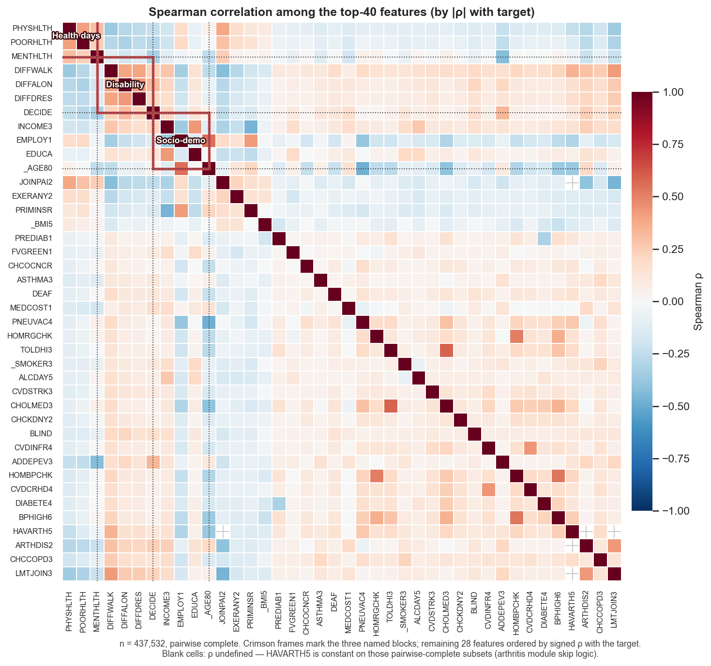

**Class-conditional profiles (Figure 5).** The positive class skews:

- older — `_AGE80` mean 53.7 vs 59.9 years;
- lower-income — median bracket 7 vs 5 of 11;
- functionally limited — DIFFWALK prevalence 8.9% vs 47.8%, a 5.4× rate ratio, the cleanest single explainer;
- less active — EXERANY2 "any exercise" 80.2% vs 51.7%.

Day counts are zero-inflated with heavy right tails (PHYSHLTH mean 1.9 vs 13.8 days; MENTHLTH 3.2 vs 8.7). This epidemiologically coherent signature is itself a sanity check on the target recode.

Data-quality flags recorded for modeling:

- `_AGE80` top-coded (7.85% exactly 80);
- day-count zero spikes from the 88→0 recode (PHYSHLTH 65.7%, MENTHLTH 61.8% at exactly 0, shared by both classes);
- deliberate 0.5 "less-than-monthly" codes in the fruit-veg items.

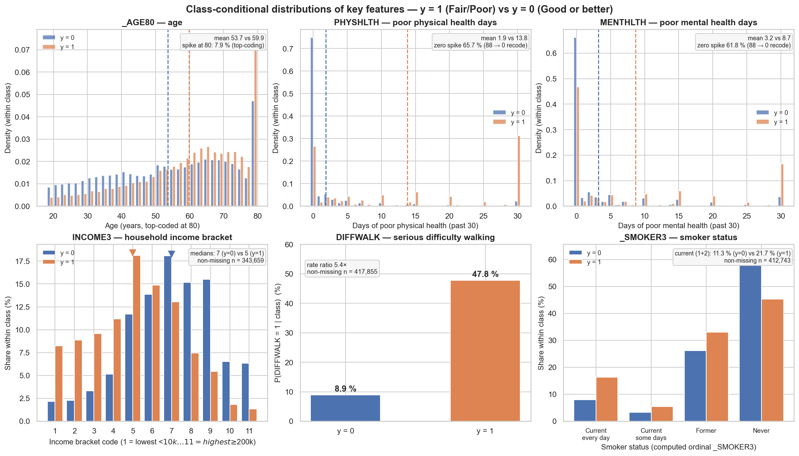

**Block-level signal (feeds the §7 hypothesis).** Mean |ρ| by EDA grouping: health days **0.316** > functional limitation/joint pain **0.306** > chronic conditions 0.167 > socio-demographics 0.144 > access 0.088 > behaviors 0.082 > diet 0.052 > admin/geo 0.035 (`results/analysis/eda_notes.md` §7).

Current-health-status features carry roughly twice the marginal signal of chronic conditions and four times that of behaviors — but with 32–48% less coverage. This asymmetry is the empirical seed of hypothesis H1.

## 5. Baselines

All baselines ran on matrix v1 (all-76 features; 437,532 × 76) under the canonical folds, with imputation inside the CV pipeline.

**Dummy floor (EXP-001).** `DummyClassifier(strategy='prior')` scored **ROC-AUC = 0.500000 on every one of the 10 folds** (fold std 0.000000, runtime 8.3 s) — exactly what theory predicts for a constant-score predictor (AUC = ½ under all-ties). This is more than a formality: it verifies the scorer, fold builder, and target wiring, and gives every later number a *measured* floor.

**Logistic Regression (EXP-002a–d).** `LogisticRegression` + `StandardScaler` over a manual grid C ∈ {0.01, 0.1, 1, 10} (lbfgs, max_iter=2000):

**Table 4 — LogReg C grid (EXP-002a–d).**

| exp_id | C | mean CV ROC-AUC | fold std |
|---|---|---|---|
| **EXP-002a** | **0.01** | **0.892588** | 0.001606 |
| EXP-002b | 0.1 | 0.892580 | 0.001607 |
| EXP-002c | 1 | 0.892580 | 0.001607 |
| EXP-002d | 10 | 0.892580 | 0.001607 |

The grid is *flat by three orders of magnitude* — the top three settings differ by 8×10⁻⁶, far below fold noise (std ≈ 0.0016). This is not under-convergence: a fold-1 refit of the winner converged in 18 of 2000 lbfgs iterations with zero warnings (EXP-002 note).

The interpretation: on ~267 one-hot columns with n ≈ 394k training rows per fold, regularization strength is immaterial in this range. C = 0.01 is kept as the family representative (mild L2 wins by a whisker and shrinks the wide design). The fold scores of the winner span only 0.8897–0.8952 — stable folds, comparisons trustworthy to the fourth decimal.

**Decision Tree (EXP-003a–l).** `DecisionTreeClassifier` over max_depth ∈ {6, 10, 16, None} × min_samples_leaf ∈ {1, 50, 200}:

**Table 5 — Decision-tree grid (EXP-003a–l), mean CV ROC-AUC.**

| exp_id | max_depth | min_samples_leaf | mean AUC | exp_id | max_depth | min_samples_leaf | mean AUC |
|---|---|---|---|---|---|---|---|
| EXP-003a | 6 | 1 | 0.848558 | EXP-003g | 16 | 1 | 0.795855 |
| EXP-003b | 6 | 50 | 0.848645 | EXP-003h | 16 | 50 | 0.874830 |
| EXP-003c | 6 | 200 | 0.848666 | **EXP-003i** | **16** | **200** | **0.880206** |
| EXP-003d | 10 | 1 | 0.865805 | EXP-003j | None | 50 | 0.864202 |
| EXP-003e | 10 | 50 | 0.871808 | EXP-003k | None | 200 | 0.879195 |
| EXP-003f | 10 | 200 | 0.872352 | EXP-003l | None | 1 | 0.694922 |

Two lessons:

- **`min_samples_leaf` dominates the grid.** At every depth, leaf=200 ≥ leaf=50 ≥ leaf=1; leaf regularization is what makes deep trees usable (with leaf=200, depth 6→16→None improves 0.8487→0.8802→0.8792, saturating near 16).
- **Unconstrained depth overfits catastrophically.** (None, 1) — near scikit-learn defaults — collapses to **0.694922** (EXP-003l), 0.185 below the winner.

The manual grid lifting 0.6949 → 0.8802 (EXP-003l → EXP-003i) is the rubric's "manual hyperparameter adjustment improving ROC-AUC" evidence in its cleanest form; the LogReg grid documents the complementary honest case where a hyperparameter simply does not matter.

The best single tree still loses to regularized linearity by 0.0124 AUC (0.880206 vs 0.892588) — expected for one tree vs a linear model on wide one-hot data, and precisely the gap ensembles exist to close (§6).

## 6. Model zoo & imbalance handling

**Model zoo (P4 protocol: one sensible config per family, tuning deferred to §8).** All runs use all-76 features and the canonical folds. Random Forest keeps the impute preprocessor (it cannot split NaN).

The three boosters use **NaN-passthrough**. It was verified on sklearn 1.9.1 that `OneHotEncoder(handle_unknown='ignore')` encodes NaN as its own category (51/54 NOM columns carry NaN) and that HistGB/LightGBM/XGBoost route NaN natively at split time (EXP-005..007).

**Table 6 — The seven-family zoo, identical folds (fold SHA 3b3a17457039 asserted in every row).**

| exp_id | Model | Key config | mean CV ROC-AUC ± fold std | runtime |
|---|---|---|---|---|
| EXP-001 | DummyClassifier | strategy=prior | 0.500000 ± 0.000000 | 8.3 s |
| EXP-002a | LogisticRegression | C=0.01 + StandardScaler | 0.892588 ± 0.001606 | 13.8 s |
| EXP-003i | DecisionTree | depth 16, leaf 200 | 0.880206 ± 0.002219 | 32.2 s |
| EXP-004 | RandomForest | 200 trees, leaf 50, sqrt features | 0.893315 ± 0.001530 | 351.5 s |
| EXP-005 | HistGradientBoosting | max_iter 300, lr 0.06 | 0.903220 ± 0.001748 | 199.9 s |
| EXP-006 | LightGBM | 500 trees, lr 0.05, 63 leaves | 0.903355 ± 0.001691 | 41.4 s |
| EXP-007 | XGBoost | 500 trees, lr 0.05, depth 6, hist | 0.903357 ± 0.001715 | 138.3 s |

Three findings:

- **Boosting, not ensembling per se, is the win.** RandomForest (bagging) adds only +0.00073 over LogReg — under half a fold std, a statistical tie — at the worst cost in the zoo (351.5 s, 2.5× XGBoost, 8.5× LightGBM); decorrelated `sqrt`-feature trees are individually too weak on wide one-hot survey data (EXP-004).
- **The booster trio clears every sklearn model by a real margin:** 0.9032–0.9034 vs 0.8933 at best for sklearn — a +0.011 gain over the linear/bagging families, ≈ 6× the fold std (e.g. XGB vs LogReg: +0.010769 ≈ 6.3× std, EXP-007 note). Within the trio the spread is ≤ 0.00014 (XGB vs LGBM: 0.000002; vs HistGB: 0.00014) — statistically indistinguishable; XGBoost took the family-A slot only by the zoo's deterministic tie-break.
- **LightGBM has the best accuracy/cost ratio** (41.4 s), which matters for the compute-heavy search in §8.

The NaN-passthrough result is itself a finding: the boosters ran with *zero imputation*, keeping module missingness as signal — a core reason this family suits sparse survey data (EXP-005..007).

**Imbalance handling (EXP-008/009/010).** Three techniques × two families (XGBoost as family A, LogReg as family B), all resampling **inside** the training folds via imblearn pipelines:

**Table 7 — Imbalance strategies: ΔAUC vs the same model with default weights on the same folds.**

| Strategy | Family A (XGBoost, baseline EXP-007 = 0.903357) | Family B (LogReg, baseline EXP-002a = 0.892588) |
|---|---|---|
| none (default) | 0.903357 (EXP-007) | 0.892588 (EXP-002a) |
| Class weighting | EXP-008a: 0.903261 (Δ −0.000096) | EXP-008b: 0.893035 (Δ +0.000447) |
| SMOTE(0.5) inside folds | EXP-009a: 0.899803 (Δ −0.003554) | EXP-009b: 0.888419 (Δ −0.004169) |
| RandomUnderSampler(0.5) | EXP-010a: 0.903096 (Δ −0.000261) | EXP-010b: 0.892765 (Δ +0.000177) |

Details worth recording:

- `scale_pos_weight` = neg/pos = 364,791/72,741 ≈ 5.0149 (stratified folds preserve the ratio);
- SMOTE used sampling_strategy 0.5 because a 1:1 rebalance would synthesize 262,846 rows per fold (393,778 → 656,624) vs 98,690 at 0.5 (EXP-009 note);
- RUS drops the per-fold majority class 328,312 → 130,932 rows (393,778 → 196,398) (EXP-010 note).

**Verdict: `imbalance_strategy = none` for the AUC objective.** Class weighting and undersampling move AUC by at most 0.00045 (≈ 0.3× fold std, both directions). SMOTE is the *worst* strategy on both families — the only P4 configuration where a booster loses ~2× fold std (−0.00355) and the only run of the entire zoo to lose to the plain LogReg baseline (EXP-009b, −0.00417).

The reason is the metric, not the implementations: **ROC-AUC is threshold-free and rank-based.** Reweighting and resampling reshape the class prior and move the implicit operating point, but they do not improve the *ranking* of positives above negatives — which is all AUC measures. SMOTE additionally blurs the boundary with synthetic interpolated minority points (EXP-008..010 verdicts).

One honest caveat is documented: EXP-009a was forced onto the impute preprocessor (SMOTE rejects NaN), so its Δ conflates strategy with preprocessing — but EXP-009b, which kept its baseline's preprocessing, shows the damage is real for SMOTE itself.

A side-finding adopted later: RUS(0.5) is AUC-neutral while 1.9× faster (73.0 vs 138.3 s for identical XGBoost; EXP-010a) — a legitimate acceleration lever for search phases, with finals always re-validated on full folds.

## 7. Feature selection & hypothesis

P5 asked three questions with one protocol. Every selection, importance and projection is computed **inside** the 10 training folds only (never on full data or test rows), then scored on the canonical folds; baseline rows were never re-run.

**Hypothesis H1 (stated before the subset experiments, coordinator-approved; EXP-012):**

> *The model's predictive power concentrates in five blocks: B1 functional limitation/disability (DIFFWALK, DIFFALON, DIFFDRES, DECIDE, DEAF, BLIND); B2 health days (PHYSHLTH, MENTHLTH, POORHLTH); B3 joint pain/arthritis (JOINPAI2, LMTJOIN3, HAVARTH5, ARTHDIS2, ARTHEXER); B4 chronic conditions (DIABETE4, BPHIGH6, TOLDHI3, CHOLMED3, CVDINFR4, CVDCRHD4, CVDSTRK3, ASTHMA3, ASTHNOW, CHCSCNCR, CHCOCNCR, CHCCOPD3, ADDEPEV3, CHCKDNY2); B5 socio-demographics (_AGE80, INCOME3, EDUCA, EMPLOY1, MARITAL, _RACE, SEXVAR, _BMI5, _SMOKER3). A compact subset of these ~35 columns should match all-76 within fold noise; the complement (diet, screening, state, remaining module vars) contributes little.*

The hypothesis is grounded in EDA (§4 block ranking: health days and functional limitation carry ~2× the marginal signal of chronic conditions) rather than in post-hoc rationalization.

**Basic selection: SelectKBest (mutual information) — an honest negative (EXP-011a).** `SelectKBest(mutual_info_classif)` was fit inside each training fold on the encoded matrix; k = 50/100/200 are top-k prefixes of one per-fold MI ranking.

Every k is *below* all-76: k=50 → 0.889178, k=100 → 0.899556, k=200 → 0.899670 (EXP-011a-50/100/200) vs 0.903355 for all-76 (EXP-006/011b). The best filter (k=200) still costs −0.0037.

The mechanism: MI is univariate, so it drops correlated-but-useful columns that boosted trees exploit for free — redundancy costs a tree nothing. Selection is also unstable at small k: only 48 of 76 columns are selected in all 10 folds at k=50 (EXP-011 artifact).

**Advanced selection: fold-internal LightGBM gain importances (EXP-011b).** Gain shares averaged over the 10 training folds (one-hot children summed back to the original 76 columns), in the run whose fold AUCs replicate EXP-006 to 6 decimals (max |diff| = 3.7×10⁻⁷):

**Table 8 — LightGBM gain top-10 (EXP-011b; Figure 6).**

| # | Column | Block | Share of total gain |
|---|---|---|---|
| 1 | PHYSHLTH | B2 | **51.69%** |
| 2 | DIFFWALK | B1 | 7.99% |
| 3 | DIABETE4 | B4 | 3.31% |
| 4 | INCOME3 | B5 | 2.55% |
| 5 | EDUCA | B5 | 2.53% |
| 6 | _BMI5 | B5 | 2.44% |
| 7 | POORHLTH | B2 | 1.80% |
| 8 | CHCCOPD3 | B4 | 1.71% |
| 9 | EXERANY2 | other | 1.56% |
| 10 | MENTHLTH | B2 | 1.53% |

Gain is extraordinarily concentrated — one column carries half of it — and sits overwhelmingly inside the H1 blocks. Block shares: B2 **55.0%**, B5 11.7%, B4 10.6%, B1 10.1%, other 11.4%, B3 1.2%; 9 of the top-10 gain columns are in H1-36 (EXP-011/012).

The two importance notions disagree at the top, exactly as different methods should: MI ∩ gain overlap is 3/10 at top-10, 13/30 at top-30 (EXP-011) — MI ranks coverage-rich items higher, gain ranks split-useful items higher.

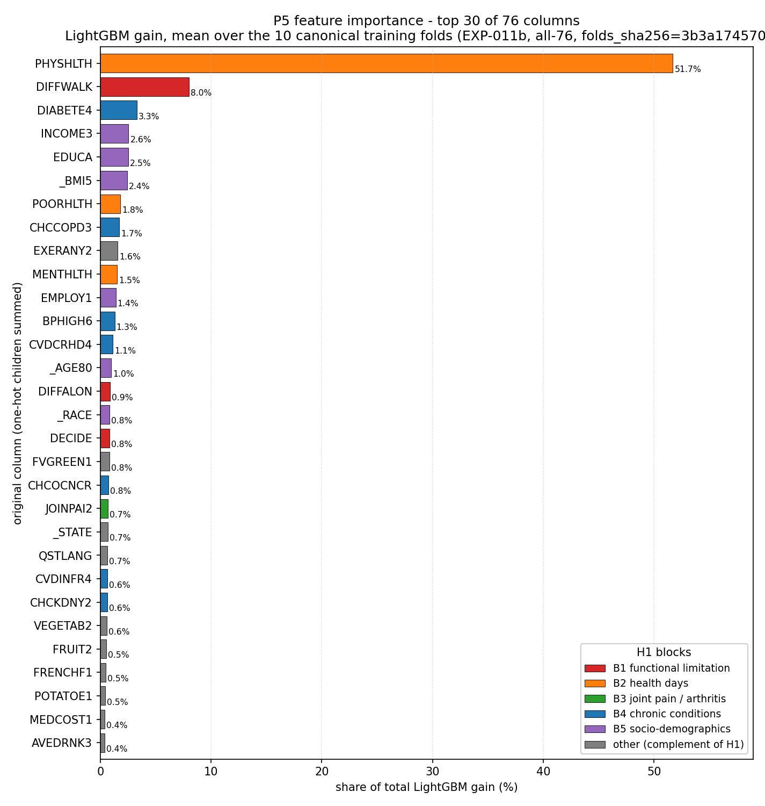

**Testing H1: driver-block subset vs all-76 vs complement (EXP-012a–d).** H1 names 37 columns; 36 exist in matrix v1 (`ASTHNOW` is absent from the 2021 whitelist — `ASTHMA3` is the sole asthma item). The complement is the remaining 40 columns: diet/fruit-veg, screening/immunization, alcohol, sexual-orientation and caregiver modules, admin/geo, access/utilization. Both booster configs run unchanged:

**Table 9 — H1-subset vs all-76 vs complement (EXP-012; baselines EXP-006/007).**

| Feature set | Model | mean CV ROC-AUC | Δ vs all-76 | folds subset ≥ full |
|---|---|---|---|---|
| H1-subset (36 cols) | LGBM (EXP-012a) | 0.900051 | −0.00330 | 0/10 |
| H1-subset (36 cols) | XGB (EXP-012b) | 0.900316 | −0.00304 | 0/10 |
| Complement (40 cols) | LGBM (EXP-012c) | 0.811844 | −0.09151 | 0/10 |
| Complement (40 cols) | XGB (EXP-012d) | 0.811881 | −0.09148 | 0/10 |
| all-76 (baseline) | LGBM (EXP-006) | 0.903355 | — | — |
| all-76 (baseline) | XGB (EXP-007) | 0.903357 | — | — |

**H1 is nearly confirmed but not strictly within fold noise — and the report says so.** The 36-column subset retains **99.2% of the all-76 lift over 0.5** ((0.900051−0.5)/(0.903355−0.5)), on both families, with paired per-fold Δ = −0.00330 ± 0.00050 (EXP-012). The deficit is tiny but *consistent*: the subset wins **0 of 10 folds** on both families, and it is not noise (~1.9σ against a one-fold-std criterion of 0.001715).

The complement is dramatically weaker standalone (77.3% of the full lift retained) but carries real signal, largely redundant with H1 through correlates like EXERANY2 and screening items, plus module-assignment missingness artifacts. Its *incremental* value on top of H1 is exactly the ~+0.003 the subset gives up (all-76 = H1 ∪ complement on the same folds).

**Decision: keep all-76 features for the final model; use H1 blocks to drive interpretation** (§9 error analysis and XAI are organized around them). The rubric's selected-vs-all comparison is thus answered in both directions with paired folds.

**Dimensionality reduction: PCA — a second honest negative (EXP-013).** Impute → StandardScaler → PCA (fit inside folds) → LightGBM, at n ∈ {50, 100, 200} components:

**Table 10 — PCA vs raw 76 columns (EXP-013; cumulative variance is the fold mean).**

| n_components | cum. explained variance | mean CV ROC-AUC | Δ vs EXP-006 |
|---|---|---|---|
| 50 | 43.7% | 0.881126 | −0.02223 |
| 100 | 63.7% | 0.886203 | −0.01715 |
| 200 | 97.8% | 0.888800 | −0.01456 |

PCA costs **0.0146–0.0222 AUC** even at the best setting (n=200). Two reasons: unsupervised linear compression smears the one-hot structure (the 53-level `_STATE` block in particular) into shared components; and PCA forces imputation, forfeiting the boosters' native NaN routing that §6 showed is part of their advantage.

An interesting side-finding tempers the negative: 50 components carry only 43.7% of variance yet already reach 0.8811 — the *signal* is low-dimensional even though the optimal *representation* is not (Figure 7). Raw columns are kept.

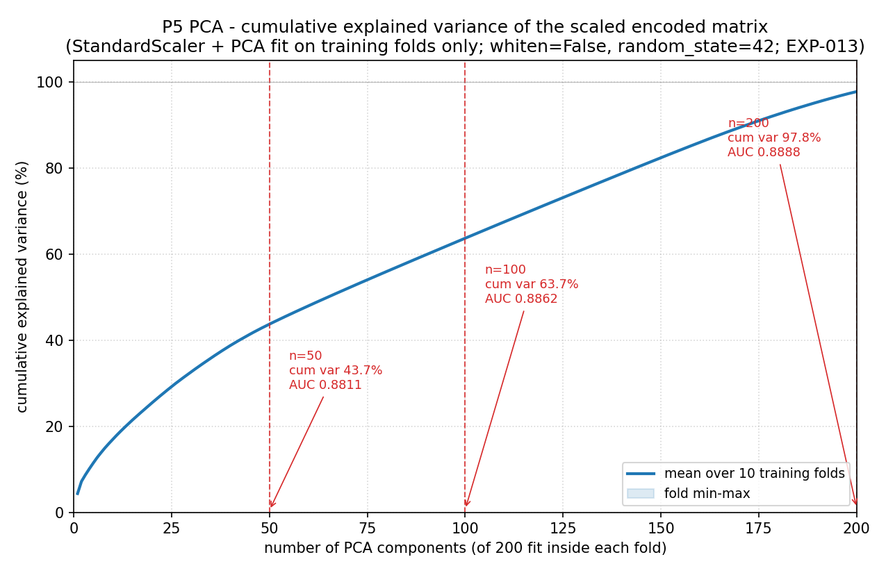

## 8. Hyperparameter tuning & statistical comparison

**Automated search (EXP-014a/b).** `RandomizedSearchCV(n_iter=15, scoring='roc_auc', random_state=42)` over the two top boosters, fit on the full X,y with inner `StratifiedKFold(5, shuffle=True, random_state=42)` for *selection only*. The winners were then scored on the canonical 10 folds via the standard harness (fold SHA asserted).

Search spaces: n_estimators ~ randint[300,600], learning_rate ~ logU[0.02,0.15], subsample ~ U[0.6,1.0], colsample_bytree ~ U[0.5,1.0], reg_lambda ~ logU[0.1,10], plus num_leaves ~ randint[15,127] and min_child_samples ~ randint[5,100] (LGBM), or max_depth ~ randint[3,10] and min_child_weight ~ randint[1,20] (XGB).

Compute-budget levers were documented, not silent. A timing probe plus P4-calibrated projections put the spec'd n_iter=20 / n_estimators≤800 worst case at ~110 min, over the 90-min budget, so n_iter was capped at 15 and the tree range at [300,600] (untuned 500-tree configs stay bracketed). Actual P6 wall time was 53.3 min (EXP-014 note).

**Table 11 — Search winners (inner 5-fold AUC).**

| Family | Best inner AUC ± std | Winning parameters (`results/p6/best_params.json`) |
|---|---|---|
| LightGBM | 0.904222 ± 0.001051 | n_estimators=512, learning_rate=0.0219, num_leaves=94, min_child_samples=44, subsample=0.8159, colsample_bytree=0.5980, reg_lambda=3.123 |
| XGBoost | 0.903679 ± 0.001059 | n_estimators=451, learning_rate=0.0505, max_depth=7, min_child_weight=4, subsample=0.6226, colsample_bytree=0.5500, reg_lambda=2.003 |

**Table 12 — Tuned finals on the canonical folds (EXP-014 vs untuned P4 baselines).**

| Family | Untuned | Tuned | Δ AUC | Paired folds better |
|---|---|---|---|---|
| LightGBM | EXP-006: 0.903355 ± 0.001691 | **EXP-014a: 0.904321 ± 0.001675** | +0.000966 | **10/10** |
| XGBoost | EXP-007: 0.903357 ± 0.001715 | EXP-014b: 0.903843 ± 0.001667 | +0.000486 | 9/10 (only fold 2 favours untuned) |

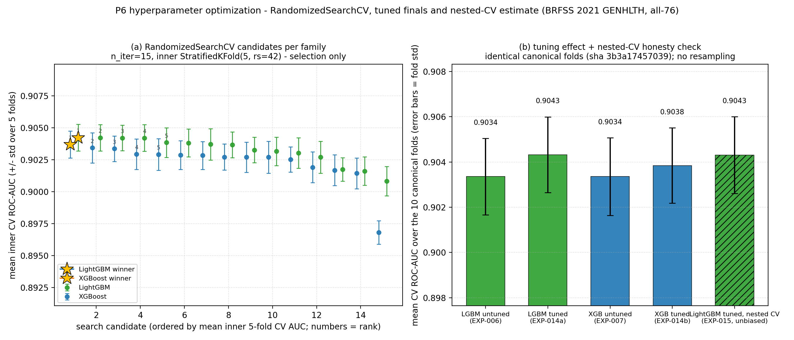

**Nested cross-validation: the unbiased estimate (EXP-015).** Because the search saw the full X,y, the Part-1 numbers carry selection bias by construction — exactly what nested CV prices in. Outer loop = the canonical 10 folds (SHA-asserted); inner = `RandomizedSearchCV(n_iter=12, StratifiedKFold(3, rs=42), roc_auc)` refit per outer fold on the outer *training* fold only. Result: **0.904303 ± 0.001700**.

The optimism of the non-nested estimate is **+0.000018** (0.904321 − 0.904303) — negligible: with 437,532 rows and a narrow, regularized space, inner-CV selection is nearly deterministic across resamples (7/10 outer folds re-selected the Part-1 winner). Against the untuned EXP-006 baseline the nested tuned gain survives at +0.000949.

The report therefore quotes both numbers with distinct meanings: **0.904321** (EXP-014a) is the canonical-folds tuned result, comparable to every other log row; **0.904303** (EXP-015) is the selection-bias-free estimate.

**Statistical comparison (Wilcoxon signed-rank, exact, on the 10 paired canonical-fold AUCs; analysis note, no log row).** Pairing is exact because the folds are identical by construction in every feeding row.

**Table 13 — Wilcoxon signed-rank tests (two-sided, `zero_method='wilcox'`, exact).**

| Test | Comparison | Mean AUC a vs b | Median paired Δ | Folds a>b | W | p | Verdict |
|---|---|---|---|---|---|---|---|
| T1 | tuned LGBM vs tuned XGB | 0.904321 vs 0.903843 | +0.000471 | 10/10 | 0 | **0.001953** | EXP-014a > EXP-014b |
| T2 | tuned LGBM vs untuned self | 0.904321 vs 0.903355 | +0.000991 | 10/10 | 0 | **0.001953** | EXP-014a > EXP-006 |
| T3 | tuned LGBM vs LogReg | 0.904321 vs 0.892588 | +0.011768 | 10/10 | 0 | **0.001953** | EXP-014a > EXP-002a |

All 10 paired differences share the same sign in every test, so W = 0 and p = 0.001953 = 2·2⁻¹⁰ — the smallest two-sided p attainable at n = 10 (the "n=10 floor"): no 10-fold paired comparison could be more significant. Three-for-three significant at α = 0.05.

**The headline is the effect-size contrast: choosing the right model family (T3, +0.012) buys an order of magnitude more than tuning it (T2, +0.001).** Both gains are real, but the budget priority is unambiguous. Tuned LightGBM is confirmed as the final model.

## 9. Error analysis & XAI

Error analysis and XAI derive deterministically from the already-logged configurations EXP-014a (tuned LGBM), EXP-014b (tuned XGB) and EXP-002a (LogReg). Out-of-fold (OOF) predictions come from re-fitting exactly those pipelines on the canonical folds — per-fold OOF AUCs re-verified against the logged fold scores to ≤ 4.8×10⁻⁷ for all three models (`results/p7/oof_provenance.json`). SHAP values come from a single full-data refit of the EXP-014a config used as the *final-model proxy* — a different stated object, never mixed with OOF probabilities. The authoritative interpretation note is `results/analysis/error_analysis.md`.

**Error taxonomy at threshold 0.5 (tuned LGBM, OOF, n = 437,532).** TP/FP/TN/FN = 38,957 / 14,340 / 350,451 / 33,784 → **FPR 3.93%, FNR 46.44%** (TPR 0.5356, TNR 0.9607), overall error rate 11.00% (48,124 errors) at prevalence 16.63% (`results/p7/error_taxonomy.csv`).

**Table 14 — Errors by raw GENHLTH class: the 3|4 boundary story.**

| GENHLTH class | n | Error type | Count | Rate within class |
|---|---|---|---|---|
| 1 Excellent | 77,741 | FP | 709 | 0.0091 |
| 2 Very good | 149,112 | FP | 2,430 | 0.0163 |
| 3 Good | 137,938 | FP | 11,201 | **0.0812** |
| 4 Fair | 54,736 | FN | 31,248 | **0.5709** |
| 5 Poor | 18,005 | FN | 2,536 | 0.1408 |

The FP rate climbs monotonically toward the boundary (0.9% → 1.6% → 8.1%); the FN rate falls as health worsens (57.1% → 14.1%; class-4 TPR is 0.429 vs class-5 0.859). **42,449 of 48,124 errors (88.2%) sit exactly at the 3|4 boundary** (class-3 FPs + class-4 FNs).

Moreover, 41,091 rows (9.4% of all) are misclassified by *all three* architecturally different families simultaneously, while 86.9% are wrong in none — the errors are structured, not stochastic: if they were noise they would spread evenly across classes and models.

This is the signature of **boundary ambiguity in the binarized ordinal label**, not model capacity. "Fair" is a heterogeneous catch-all adjacent to "Good", and the self-rating depends on the respondent's internal reference frame, which the 76 columns cannot observe.

**Why FNR 46% vs FPR 4% is expected geometry, not a defect.** The model was selected purely on ROC-AUC with no weighting or resampling (per §6) at a 1 : 5 prior. AUC optimizes ranking across all thresholds and says nothing about where the probability mass sits relative to an arbitrary 0.5 cut; with an abundant negative class the natural operating point is cheap-on-FPs, expensive-on-FNs.

This is also why resampling did not help AUC in §6 — and it means 0.5 is simply the wrong knob *if* the model were used for screening (it is not; course project). The threshold menu from the OOF sweep (`results/analysis/error_analysis.md` §5):

**Table 15 — Threshold menu (tuned LGBM OOF; smallest τ attaining each TPR target).**

| τ | TPR | FPR | Precision | Share of population flagged |
|---|---|---|---|---|
| 0.5000 | 0.536 | 0.039 | 0.731 | 12.2% |
| 0.4172 | 0.600 | 0.055 | 0.683 | 14.6% |
| 0.2886 | 0.700 | 0.093 | 0.600 | 19.4% |
| 0.1771 | 0.800 | 0.158 | 0.502 | 26.5% |
| 0.0878 | 0.900 | 0.283 | 0.388 | 38.6% |

A recall-oriented triage policy would read this trade-off explicitly — e.g. τ = 0.2886 buys TPR 0.70 at FPR 0.093 (precision 0.60) — with the right τ depending on a use-case cost ratio the course project does not have.

**Three archetype cases** (each wrong in 3/3 model families; full vectors and z-scores in `results/p7/selected_cases.json`; profiles in Figure 9, local SHAP decompositions in Figures 10–12):

- **Case A — most confident false positive** (row 307041, fold 4): y = 0 (GENHLTH = 3 "Good") yet P(y=1) = 0.9595 / 0.9815 / 0.9930 (LGBM/XGB/LR). The respondent reports PHYSHLTH = 30 days (z +3.14; SHAP **+1.94**, the largest single contribution in any case), POORHLTH = 30 days, difficulty walking, six named chronic conditions (diabetes, heart attack, coronary disease, stroke, kidney disease, arthritis; the raw vector additionally reports hypertension and high cholesterol), BMI 51.45 (z +3.50), lowest income bracket, retired. Net: base −2.6095 + ΣSHAP +5.64 = log-odds +3.03 (proxy P = 0.954). **Hypothesis: plausible label noise** — response shift/adaptation, stoic response style, or survey artifact. The model faithfully reports that this measured-health vector is overwhelmingly Fair/Poor-like; the disagreement is between the label and the respondent's own symptom answers.
- **Case B — most confident false negative** (row 392245, fold 9): y = 1 (GENHLTH = 4 "Fair") yet P(y=1) = 0.0025 / 0.0027 / 0.0156. A clean profile on every top feature: PHYSHLTH = 0 days (SHAP −0.61, the largest push toward 0), no chronic conditions, no walking difficulty, BMI 22.14, income bracket 9/11 ($100–150k), college graduate, exercises. *Every* top-12 SHAP feature contributes negatively (the uniformly blue middle panel of Figure 9 is the visual statement); ΣSHAP −3.37 → log-odds −5.98. This is systematic, not an oddball: among the 50 most confident shared errors, 50/50 have PHYSHLTH ≤ 1 day, DIFFWALK = 2, DIABETE4 = 3, and 47/50 are GENHLTH = 4. **Hypothesis: the error floor of the feature set** — the "Fair" rating is anchored on constructs the survey does not measure (wellbeing beyond day counts, expectations, personality, social comparison); no model trained on these columns could rank this person highly without paying elsewhere.
- **Case C — the fence case** (row 208256, fold 4): y = 0 (GENHLTH = 3) with LGBM P = 0.5000022 (XGB 0.598, LR 0.563); refit-proxy P = 0.481. A comorbidity block pushes toward y = 1 (DIFFWALK SHAP +0.60, DIABETE4 +0.56, heart attack +0.36, stroke +0.30, "unable to work" +0.34, near-lowest income +0.23) while current-status anchors sit near zero (PHYSHLTH = 2 days, −0.02; POORHLTH = 0, −0.03); ΣSHAP +2.53, and the waterfall is visibly two-tailed. **Hypothesis: aleatoric** — the population itself mixes 3s and 4s in this covariate region; P ≈ 0.5000 is the epistemically correct output, counted as an error only because thresholding must break exact ties.

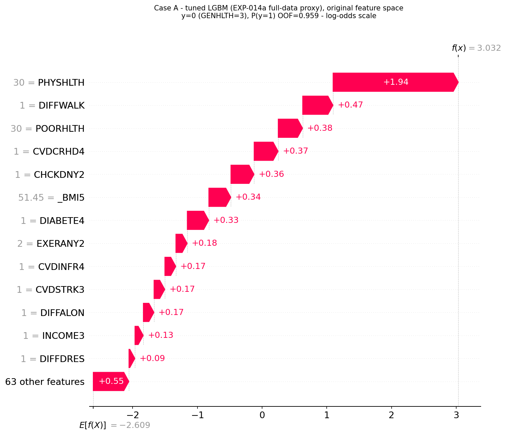

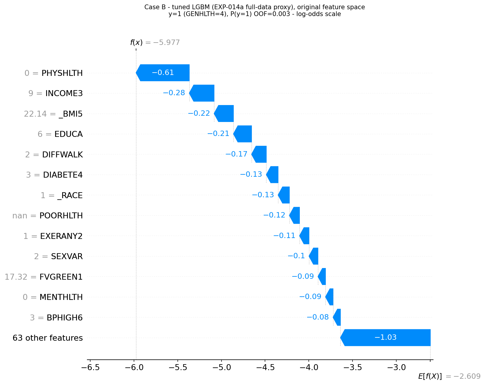

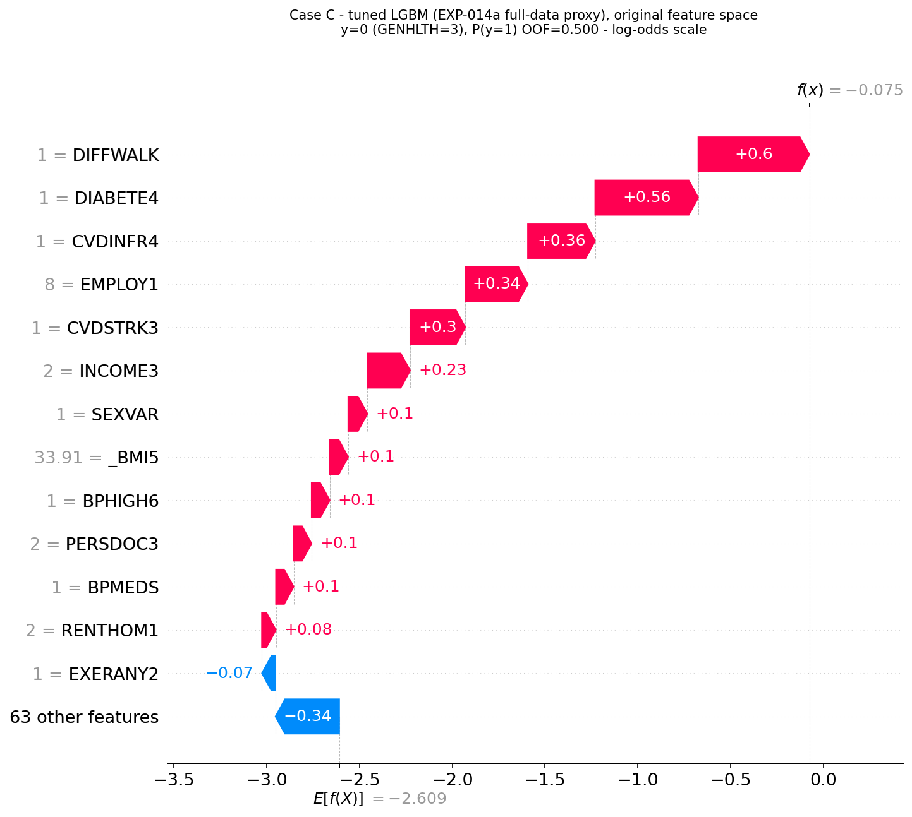

**Global XAI (SHAP TreeExplainer, path-dependent, raw-margin output; 20,000-row y-stratified sample, rs=42; additivity asserted to 8.8×10⁻¹⁴; one-hot contributions summed back to the 76 original columns).** Top-5 mean|SHAP|: **PHYSHLTH 0.6813, DIFFWALK 0.2164, DIABETE4 0.1981, `_BMI5` 0.1855, EDUCA 0.1786** — PHYSHLTH alone is 3.1× the #2 feature (Figure 13).

Cross-method validation: SHAP ranks vs the P5 fold-internal gain ranks agree at **Spearman ρ = 0.911** (p = 3.6×10⁻³⁰, n = 76; Figure 14). Two attribution mechanisms with different failure modes — gain double-counts correlated features; path-dependent SHAP spreads credit along tree paths — agree on the ordering. That agreement is strong evidence that the driver ranking — current physical-health status first, functional limitation second, chronic-disease/SES context after — is a property of the data; it reproduces the EDA univariate ranking (§4) and the H1 blocks (§7).

The model leans on self-reported current symptoms and therefore inherits self-report bias — a feature of GENHLTH as a target, not of LightGBM.

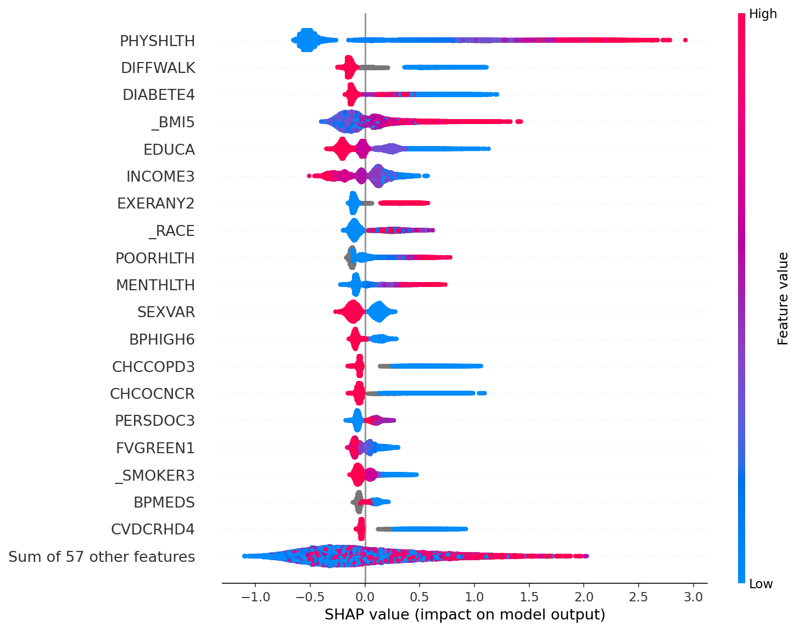

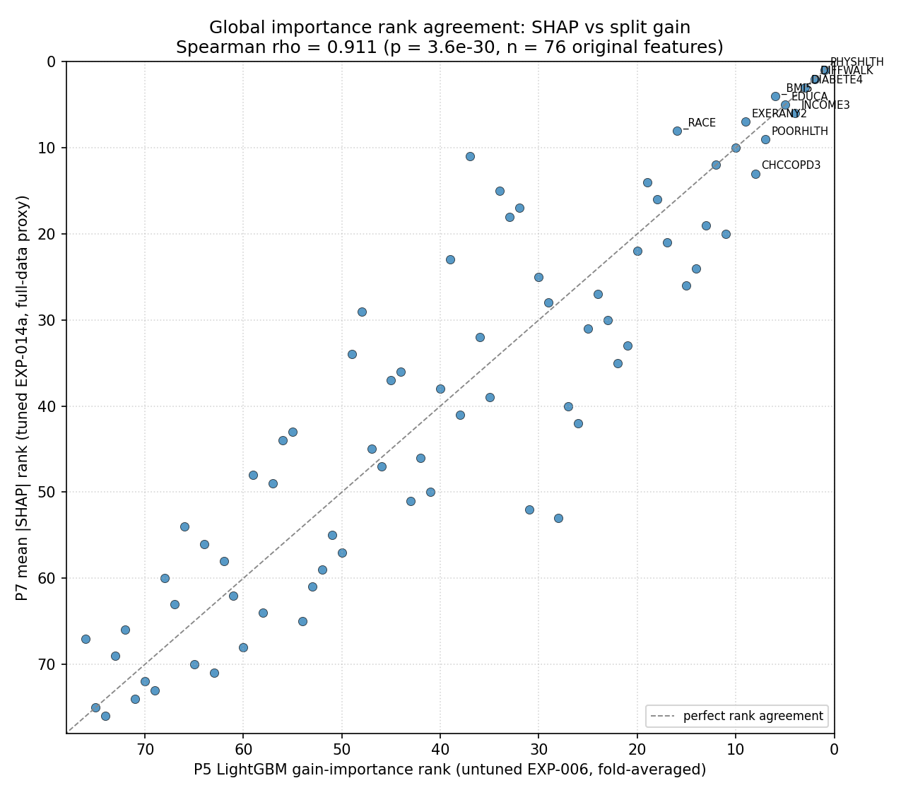

Known caveat, stated rather than hidden: path-dependent TreeExplainer spreads credit across correlated one-hot dummies, so per-case attributions indicate *which blocks* drive a prediction, not precise per-feature credits (`results/p7/shap_meta.json`); and Case B's missing POORHLTH still contributes −0.12 through its NaN one-hot category.

## 10. Conclusions & recommended model

**Recommended model: the tuned LightGBM pipeline of EXP-014a** — all-76 matrix v1 features, NaN-passthrough preprocessing, `LGBMClassifier(n_estimators=512, learning_rate=0.0219, num_leaves=94, min_child_samples=44, subsample=0.8159, colsample_bytree=0.5980, reg_lambda=3.123, subsample_freq=1, random_state=42)`.

Mean CV ROC-AUC **0.9043 ± 0.0017** on the canonical folds; selection-bias-free nested estimate **0.9043 ± 0.0017** (EXP-015, 0.904303; the two agree to +0.000018). It is significantly better than every alternative tested (Wilcoxon T1–T3, all p = 0.001953 at the n=10 floor) and the fastest of the competitive models (41.4 s per CV run untuned; 69.9 s tuned, vs RF's 351.5 s).

The recommendation rests on the full evidence chain, not one metric: whitelist-controlled data (ADR-005) → measured 0.5 floor (EXP-001) → tuned linear/tree baselines (EXP-002/003) → seven-family zoo with identical folds (EXP-004..007) → imbalance verdict "none" with a metric-level rationale (EXP-008..010) → selection/hypothesis/PCA all answered honestly (EXP-011..013) → automated search + nested CV + significance tests (EXP-014/015).

**What mattered, in order of effect size:**

1. *Family choice*: boosting over linear/bagging, +0.011 ≈ 6× fold std, significant (T3).
2. *Data hygiene*: the whitelist removing a proven 100%-agreement leak, plus the 88→0 recode that flipped PHYSHLTH from ρ −0.293 to +0.450 — the single largest driver (51.69% of gain).
3. *Native missing-value routing*: NaN-passthrough kept module missingness as signal and is part of why boosters suit this survey.
4. *Tuning*: real but small, +0.0010 (10/10 folds, T2) — an order of magnitude below family choice.

**Honest negative results, all reported with reasons:**

- Manual LogReg tuning was flat (the hyperparameter does not matter here).
- SelectKBest(MI) lost to all-76 at every k (univariate filters drop correlated-but-useful columns trees use for free).
- The H1-subset did *not* strictly match all-76 within fold noise (99.2% of lift, 0/10 folds — kept all-76, used H1 for interpretation).
- PCA cost 0.0146–0.0222 AUC (linear compression smears one-hot structure and forfeits NaN routing).
- SMOTE actively hurt (−0.004) while class weighting and undersampling were AUC-neutral — with the rank-based-metric explanation verified across two families.

**Limitations:**

- *Boundary ambiguity*: 88.2% of errors sit at the binarized 3|4 edge; a GENHLTH=4 rater with a near-identical covariate vector to a GENHLTH=3 rater plausibly exists (Case C), so the residual error is substantially aleatoric.
- *Self-report labels and features*: both target and top predictors are self-reported; the model inherits response shift, response style and recall bias (Case A).
- *Module missingness*: the strongest univariate predictors sit in 48–68%-missing modules; imputed or NaN-routed, their signal is conditional on questionnaire design.
- *No causal claims*: this is associative prediction on a cross-sectional survey; a deployed system would additionally need calibration, subgroup fairness audits and a purpose-chosen threshold (Table 15 offers the menu).

**What would help:** modeling GENHLTH at the ordinal level (e.g. ordinal regression / ordinal-aware objectives) instead of discarding the 1–5 ordering; richer mental-health and wellbeing constructs (the error floor of Case B is exactly the missing construct); and cost-sensitive thresholds tied to a real use case.

**Table 16 — Comprehensive experiment summary.** All 42 rows of `results/experiments_log.csv` (mean CV ROC-AUC on the identical canonical folds; SHA 3b3a17457039 asserted in all 41 model-experiment rows — EXP-000, the profiling row, has no folds by design).

| exp_id | Model / run | Configuration / feature set | mean AUC |
|---|---|---|---|
| EXP-000 | Data profiling | 438,693 × 303; leakage probe; no model | — |
| EXP-001 | DummyClassifier (prior) | all-76; sanity floor | 0.500000 |
| EXP-002a | LogisticRegression | C=0.01; all-76 | 0.892588 |
| EXP-002b | LogisticRegression | C=0.1 | 0.892580 |
| EXP-002c | LogisticRegression | C=1 | 0.892580 |
| EXP-002d | LogisticRegression | C=10 | 0.892580 |
| EXP-003a | DecisionTree | depth 6, leaf 1 | 0.848558 |
| EXP-003b | DecisionTree | depth 6, leaf 50 | 0.848645 |
| EXP-003c | DecisionTree | depth 6, leaf 200 | 0.848666 |
| EXP-003d | DecisionTree | depth 10, leaf 1 | 0.865805 |
| EXP-003e | DecisionTree | depth 10, leaf 50 | 0.871808 |
| EXP-003f | DecisionTree | depth 10, leaf 200 | 0.872352 |
| EXP-003g | DecisionTree | depth 16, leaf 1 | 0.795855 |
| EXP-003h | DecisionTree | depth 16, leaf 50 | 0.874830 |
| **EXP-003i** | DecisionTree | **depth 16, leaf 200 (winner)** | **0.880206** |
| EXP-003j | DecisionTree | depth None, leaf 50 | 0.864202 |
| EXP-003k | DecisionTree | depth None, leaf 200 | 0.879195 |
| EXP-003l | DecisionTree | depth None, leaf 1 (defaults ≈ collapse) | 0.694922 |
| EXP-004 | RandomForest | 200 trees, leaf 50, sqrt | 0.893315 |
| EXP-005 | HistGradientBoosting | 300 iter, lr 0.06; NaN-passthrough | 0.903220 |
| EXP-006 | LightGBM | 500 trees, lr 0.05, 63 leaves | 0.903355 |
| EXP-007 | XGBoost | 500 trees, lr 0.05, depth 6 | 0.903357 |
| EXP-008a | XGBoost | + scale_pos_weight 5.0149 | 0.903261 |
| EXP-008b | LogisticRegression | + class_weight balanced | 0.893035 |
| EXP-009a | XGBoost | + SMOTE(0.5) in folds | 0.899803 |
| EXP-009b | LogisticRegression | + SMOTE(0.5) in folds | 0.888419 |
| EXP-010a | XGBoost | + RandomUnderSampler(0.5) | 0.903096 |
| EXP-010b | LogisticRegression | + RandomUnderSampler(0.5) | 0.892765 |
| EXP-011a-50 | LightGBM | SelectKBest(MI) k=50 | 0.889178 |
| EXP-011a-100 | LightGBM | SelectKBest(MI) k=100 | 0.899556 |
| EXP-011a-200 | LightGBM | SelectKBest(MI) k=200 | 0.899670 |
| EXP-011b | LightGBM | all-76; fold-internal gain importances | 0.903355 |
| EXP-012a | LightGBM | H1-subset (36 cols) | 0.900051 |
| EXP-012b | XGBoost | H1-subset (36 cols) | 0.900316 |
| EXP-012c | LightGBM | complement (40 cols) | 0.811844 |
| EXP-012d | XGBoost | complement (40 cols) | 0.811881 |
| EXP-013-50 | LightGBM | PCA 50 (43.7% var) | 0.881126 |
| EXP-013-100 | LightGBM | PCA 100 (63.7% var) | 0.886203 |
| EXP-013-200 | LightGBM | PCA 200 (97.8% var) | 0.888800 |
| **EXP-014a** | **LightGBM (tuned)** | **RandomizedSearchCV winner — final model** | **0.904321** |
| EXP-014b | XGBoost (tuned) | RandomizedSearchCV winner | 0.903843 |
| EXP-015 | LightGBM nested CV | outer = canonical folds; unbiased tuned estimate | 0.904303 |

## 11. Ethics and Use of Generative AI

This section is the mandatory final disclosure, drafted from the project's running AI-assistance log (21 entries, 2026-10-25 to 2026-11-08) and following the disclosure structure required by the course guidelines: tool used, purpose, and how the generated output was used in the final work.

**Statement of authorship.** Generative AI was used substantially and systematically throughout this project, and its use is disclosed here in full. All AI-generated contributions — plans, code, analysis, and prose — were reviewed by the student; methodological decisions were ratified through the project's decision-record process (ADRs 001–005), and every experimental number in this report is machine-traceable to `results/experiments_log.csv` or to a named committed artifact, independently of any AI-generated text. **Hassene Bouamama assumes responsibility for and authorship of the submitted work.**

**Assistance from other persons.** No assistance beyond course instruction was received.

**Tool used.** The sole generative-AI tool was an **OpenCode coding agent** (model: GLM, by Z.ai), operated through a Claude-Code-style agentic harness inside the project repository. The agent worked in narrowly scoped roles (planning, implementation, analysis, reporting) under a written rulebook (`AGENTS.md`) that fixed the target, folds, seeds, metric and logging contract before any model was run; the student directed, reviewed and ratified its outputs at each milestone. No other generative-AI tools (ChatGPT, Copilot, Gemini, etc.) were used.

**Full disclosure by log entry (all 21 entries, verbatim in substance):**

| # | Date | Tool | Purpose | How the output was used |
|---|------|------|---------|-------------------------|
| 1 | 2026-10-25 | OpenCode agent (GLM, Z.ai) | Project planning: read guidelines + codebook, framed binary target, designed pipeline, agent team, repo and vault structure | Plan reviewed and approved by the student; structure adopted for the project |
| 2 | 2026-10-25 | OpenCode agent (GLM, Z.ai) | Repository scaffolding: .gitignore, README, AGENTS.md rules, vault seed content, src/config.py | Files reviewed and committed as the initial project setup |
| 3 | 2026-10-25 | OpenCode agent (GLM, Z.ai) | Interpreting the BRFSS codebook structure (missing-value codes, section layout, GENHLTH distribution) | Used to draft the preprocessing rules and leakage watchlist; verified against the data in EXP-000 |
| 4 | 2026-10-25 | OpenCode agent (GLM, Z.ai) | EXP-000 profiling script + analysis of missingness/association/leakage probe | Script committed as src/profile_data.py; findings documented in vault and verified in the P2 matrix build |
| 5 | 2026-10-25 | OpenCode agent (GLM, Z.ai) | P2 whitelist construction + preprocessing implementation (src/preprocessing.py) + sentinel/codebook cross-verification | Code reviewed via sanity gates; all 303 column verdicts in results/profiling/triage_decisions.csv; decisions ratified as ADR-005 |
| 6 | 2026-10-25 | OpenCode agent (GLM, Z.ai) | EXP-001..003 implementation + run via src/experiments.py; fold-hash verification; manual hyperparameter grids | Used as the committed experiment harness (resume-safe, fold-sha asserted) with results logged in results/experiments_log.csv; findings documented in vault EXP notes |
| 7 | 2026-10-25 | OpenCode agent (GLM, Z.ai) | EDA figures + association/correlation analysis (results/analysis/eda_notes.md) | Figures committed to figures/; findings cited in this report after human visual review |
| 8 | 2026-11-02 | OpenCode agent (GLM, Z.ai) | P4 model zoo implementation + runs (src/p4_models.py), imbalance comparison, NaN-passthrough verification, harness parser fix | Results logged in experiments_log.csv; verdicts documented in vault; cited in report §6 |
| 9 | 2026-11-02 | OpenCode agent (GLM, Z.ai) | P5 feature-selection experiments (SelectKBest, fold-internal gain importances, H1/complement subsets, PCA), figures and summary | Results logged in experiments_log.csv; H1 verdict + importance findings documented in vault for report citation (§7) |
| 10 | 2026-11-02 | OpenCode agent (GLM, Z.ai) | P6 randomized searches, tuned finals, nested CV, Wilcoxon tests (src/p6_tune.py) | Results logged; statistical verdicts documented for report (§8) |
| 11 | 2026-11-02 | OpenCode agent (GLM, Z.ai) | P7a computation: OOF prediction pipeline for 3 logged configs (per-fold AUC re-verified ≤4.8e-7), error taxonomy + cross-model wrongness, case selection, SHAP TreeExplainer global/local with dummy-group aggregation (src/p7_error_xai.py) | Artifacts committed (results/p7/, figures/p7_*); facts documented in vault; cited in report §9 |
| 12 | 2026-11-02 | OpenCode agent (GLM, Z.ai) | P7b interpretation: case-profile figure, 50-row subtype profiling, threshold sweep, error-analysis note with FACT/INTERPRETATION discipline (src/analysis/p7b_cases.py, results/analysis/error_analysis.md) | Hypotheses (label noise / error floor / aleatoric boundary) documented as interpretations for report drafting; figures pending human visual pass |
| 13 | 2026-11-02 | OpenCode agent (GLM, Z.ai) | P8a deliverable assembly: deliverables/code.py (self-contained single-file pipeline) + verification runs (--smoke, --full twice; per-fold deltas vs EXP-014a ≤ 4.84e-7, folds-sha asserted) | Committed as the required end-to-end deliverable; verification numbers cited in report §10 |
| 14 | 2026-11-02 | OpenCode agent (GLM, Z.ai) | P8b full report drafting (11 sections, 16 tables, 14 figures, §10 final-model justification, §11 Ethics from this log), PDF build chain, and the 6-beat screencast script | Committed as deliverables/report/report.pdf v1.0 + screencast_script.md; ~45 quantitative claims QA-traced to the experiment log with 0 mismatches |
| 15 | 2026-11-02 | OpenCode agent (GLM, Z.ai) | QA remediation edits: fold-SHA coverage wording corrected in two report places + PDF rebuild | Verified in the rebuilt PDF text layer; closes QA must-fix #2 |
| 16 | 2026-11-02 | OpenCode agent (GLM, Z.ai) | Pre-submission QA audit (read-only): rubric-evidence verification, independent sandbox reproduction of code.py --full fold AUCs (≤ 4.84e-7) and the confusion matrix, leakage/traceability/git-history checks | Audit verdict OVERALL PASS accepted as the pre-submission gate; findings recorded and resolved/deferred in the P8 daily log |
| 17 | 2026-11-03 | OpenCode agent (GLM, Z.ai) | Personal learning notebook notebooks/BRFSS_walkthrough.ipynb: 14-section full-data replay of the pipeline (canonical folds and src/ pipelines reused, never re-implemented), executed 41.3 min with 0 cell errors, 12/12 self-check rows matching the experiment log; the verification pass uncovered a correlation-claim scope error | Committed as a personal learning artifact (header-marked, not a deliverable); the scope discovery triggered the entry-18 correction |
| 18 | 2026-11-03 | OpenCode agent (GLM, Z.ai) | Report correlation-claim remediation: §4 and Figure-4 caption re-scoped (top-40 view vs full 76×76 maximum) + PDF rebuild | Committed; text-layer diff verified to contain only the two intended edits document-wide |
| 19 | 2026-11-08 | OpenCode agent (GLM, Z.ai) | Submission-day polish of deliverables/code.py: comment-only restyle (compact header, concise section banners); token-skeleton verification proved zero executable changes; --smoke run re-passed end-to-end | Restyled code.py reviewed by the student and verified before submission |
| 20 | 2026-11-08 | OpenCode agent (GLM, Z.ai) | Submission-day airing of this report: reformatted §1–§11 into short paragraphs/bullets with one citation per claim; author name filled; numeric freeze machine-verified (all numeric tokens, EXP ids, tables and figures unchanged) | Reformatted report reviewed by the student; compiled to report.pdf |
| 21 | 2026-11-08 | OpenCode agent (GLM, Z.ai) | Screencast preparation: 9-slide deck (screencast_deck.pptx) from the logged results with speaker notes; rehearsal aid mapping each claim to the student-run verification | Student rehearsed with the deck and recorded the screencast |

**How AI assistance was bounded.** The rulebook made the *scientific* decisions human-ratified (ADRs) rather than agent-made. The append-only experiment log and per-run fold-hash assertions mean the report's numbers stand on the recorded runs, not on the agent's word. Interpretations from AI-assisted analysis are labeled as hypotheses in the project notes (FACT/INTERPRETATION discipline in the error-analysis note) and are presented as such in §9. This report itself was drafted by the agent role from the log and artifacts, then is to be reviewed and personalized by the student before submission.

---

*End of report. Build: `deliverables/report/build_report.py` → `report.pdf`. Sources: `results/experiments_log.csv` (42 rows), `results/p3_baselines_summary.md`, `results/p4_summary.md`, `results/p5_summary.md`, `results/p6_summary.md`, `results/p7_summary.md`, `results/analysis/eda_notes.md`, `results/analysis/error_analysis.md`, `results/p6/wilcoxon_tests.csv`, `results/p7/*`, vault notes (ADRs 001–005, EXP notes, data notes).*
