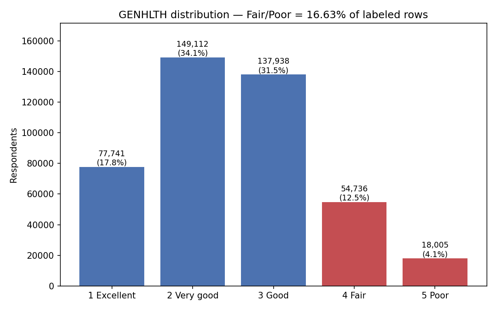
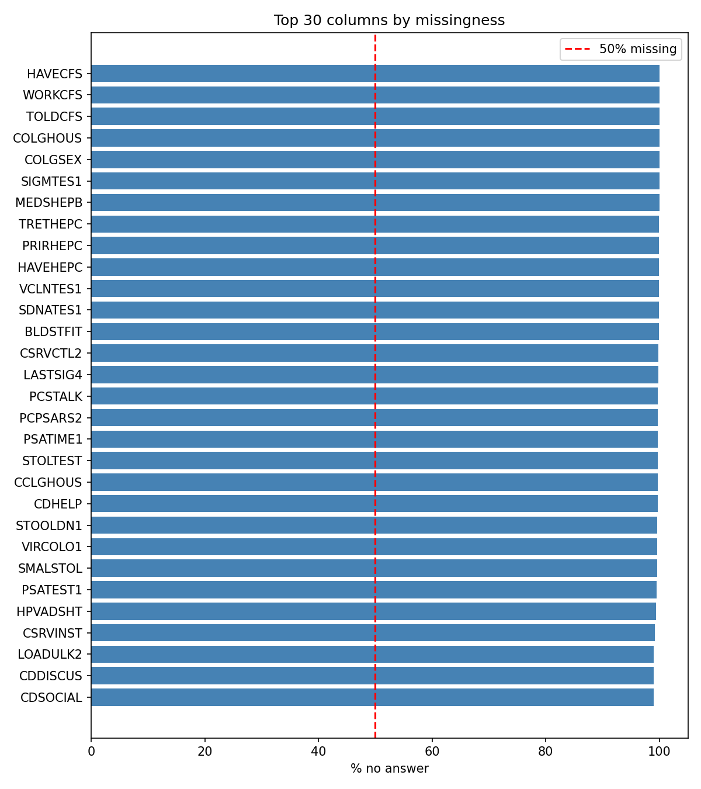
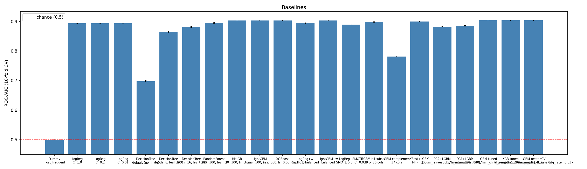
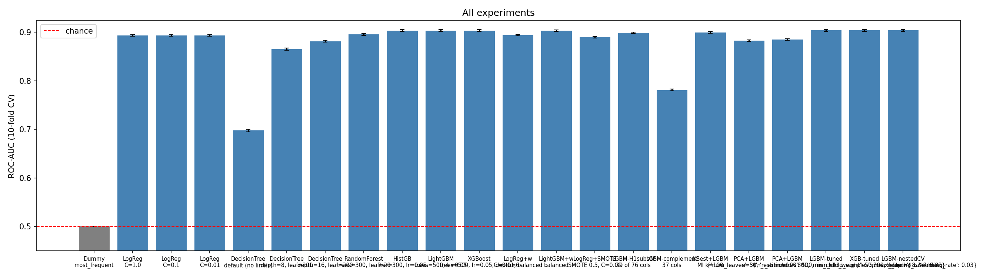
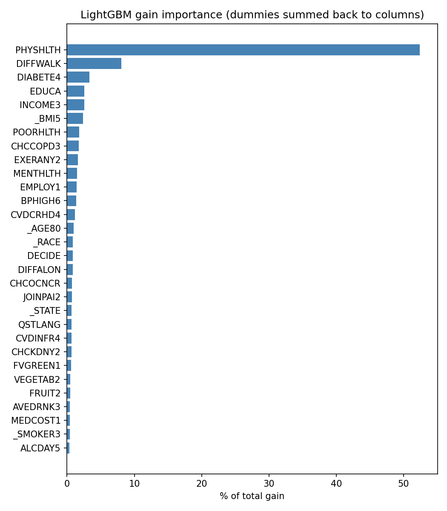
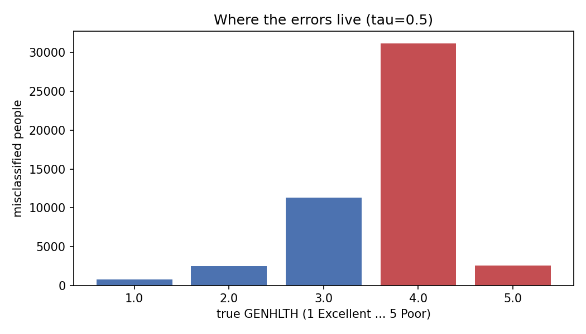
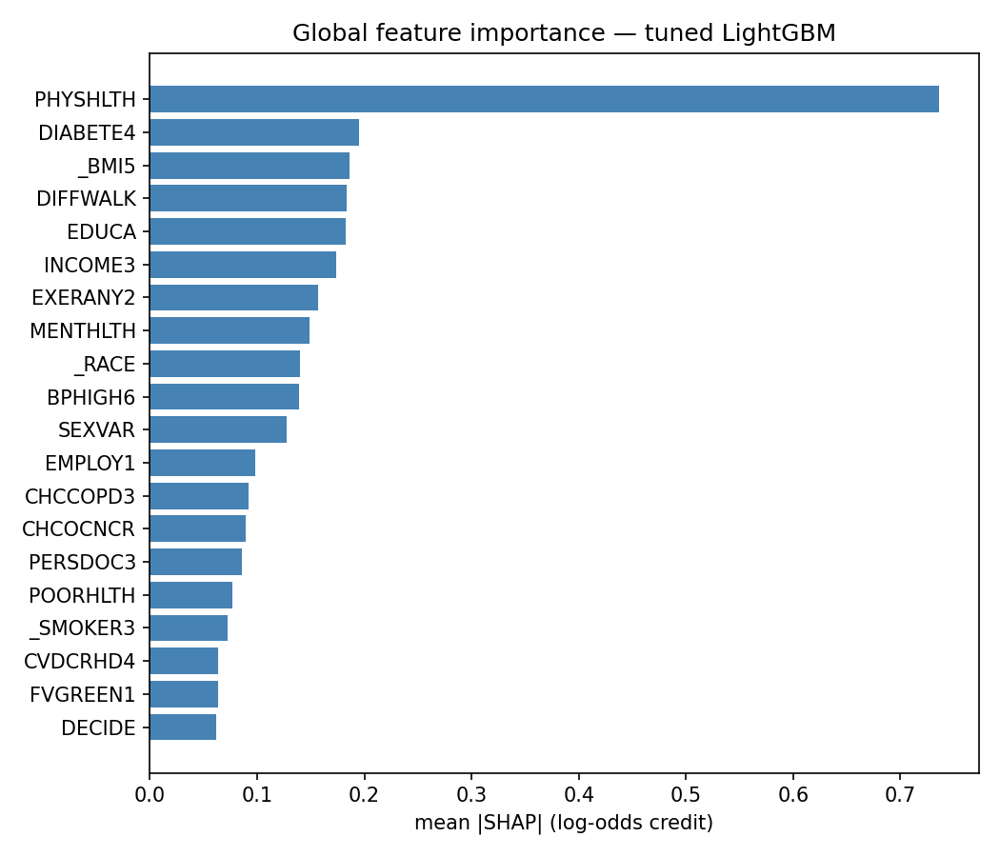
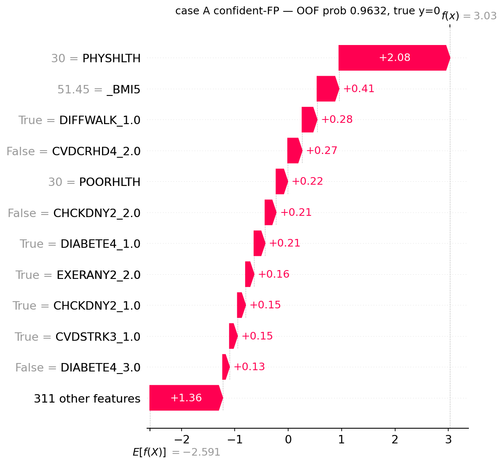
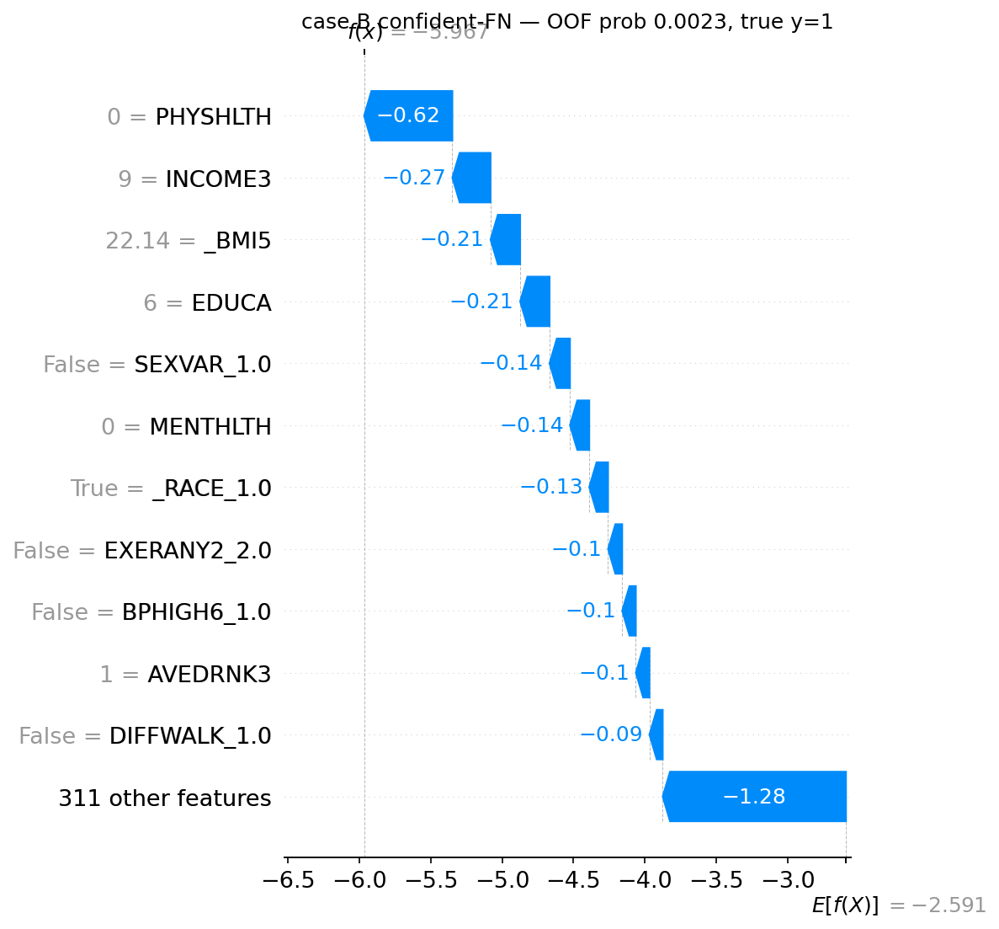
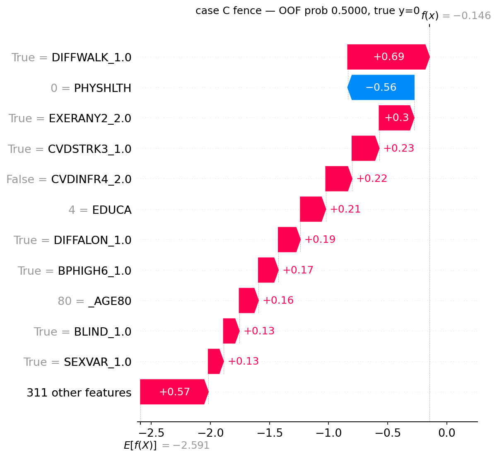

# Predicting Fair/Poor General Health on BRFSS 2021

**Binary classification · ROC-AUC · stratified 10-fold cross-validation**

Machine Learning — Final Project (C2 call)
Author: Hassene Bouamama
Date: November 8, 2026

> **Abstract.** We build a binary classifier on the CDC Behavioral Risk Factor Surveillance System (BRFSS) 2021 landline/cell survey (438,693 respondents, 303 raw columns). The target is self-reported general health: respondents rating their health *Fair* or *Poor* (GENHLTH ∈ {4,5}, 16.63% of labeled rows) form the positive class; *Excellent/Very good/Good* form the negative class. After a leakage audit, a six-rule column triage (303 → 76 columns), per-column sentinel recoding from the codebook, and one-hot encoding, we compare Dummy, Logistic Regression, Decision Tree, Random Forest, and three gradient-boosting implementations under a single fixed 10-fold split, and test class weighting and SMOTE against the class imbalance. The final model is a tuned LightGBM: mean ROC-AUC 0.903672 on the fixed folds (EXP-020), statistically tied with tuned XGBoost, confirmed by nested CV, and explained with SHAP. Every number in this report cites an experiment id traceable to `experiments.csv`; facts about the data cite the project notebook (`notebooks/BRFSS_project.ipynb`), which is the single source of truth for methods.

---

## Contents

1. Introduction and goal
2. The dataset
3. Preprocessing: from 303 columns to a clean matrix
4. Exploratory data analysis
5. Experimental setup
6. Baselines
7. Model zoo and imbalance handling
8. Feature selection and hypothesis
9. Hyperparameter tuning and statistical comparison
10. Error analysis and explainability (XAI)
11. Conclusions
12. Ethics and Use of Generative AI

---

## 1. Introduction and goal

BRFSS is the largest continuously running health survey in the world: more than 400,000 adult telephone interviews per year across the 50 US states, the District of Columbia, and three territories, covering risk behaviors, chronic conditions, and use of preventive services. Self-rated general health (GENHLTH) is one of its core items and a strong summary indicator of health status.

**Goal.** Frame the 5-class GENHLTH item as a binary problem and predict the minority side well:

- **y = 1** if GENHLTH ∈ {4, 5} (*Fair* / *Poor*) — the "needs attention" group,
- **y = 0** if GENHLTH ∈ {1, 2, 3} (*Excellent* / *Very good* / *Good*).

We deliberately chose this direction of the binary split (rather than, say, Excellent vs rest) because Fair/Poor identifies respondents with the greatest health burden, which is the operationally interesting group, and because it produces a realistic ~1:5 imbalance that the project asks us to handle explicitly.

**Metric.** ROC-AUC, estimated with stratified 10-fold cross-validation on one fixed set of folds shared by every model (Section 5). AUC is threshold-free, which matters twice here: the classes are imbalanced (~16.6% positive), and the natural use of the score is to *rank* respondents, not to hard-classify them.

**Deliverables.** A single reproducible notebook (exported to `code.py`), this report, and a screencast. The unifying principle for the whole project: *every number in the report traces back to a logged experiment, and every preprocessing decision to a written rule with evidence.*

---

## 2. The dataset

**Source.** BRFSS 2021 LLCP public file (`LLCP2021.csv`), obtained via the course server; column semantics from the official 2021 codebook (local copy in `docs/codebook.pdf`).

**Shape and types** (notebook §1.1–1.2):

- 438,693 rows × 303 raw columns.
- 245 columns arrive as `float64` and 58 as `int64`; the float columns are whole-number codes that became floats because they contain blanks. 3 columns are 100% empty.
- 20 columns have ≤ 2 distinct values (including blanks); 153 columns are >50% blank; 91 are >90% blank.

The column universe has three layers: raw questionnaire items (asked to respondents), CDC-computed columns (prefixed `_`, derived *after* the interview — prime leakage suspects), and administrative/survey-plumbing columns (weights, strata, interview metadata).

**Target definition and class distribution** (notebook §1.3). GENHLTH has five real answer categories plus sentinels. Rows with target = 7 (*don't know*, 788 rows), 9 (*refused*, 369 rows), or blank (4 rows) — 1,161 rows, 0.26% — are **dropped, never imputed**: a guessed label is a wrong label, and the target must never be imputed. That leaves **437,532 labeled rows**.

Table 1 — GENHLTH distribution over labeled rows (notebook §1.3).

| GENHLTH | Meaning | n | % of labeled rows | Binary y |
|---|---|---:|---:|---|
| 1 | Excellent | 77,741 | 17.8% | 0 |
| 2 | Very good | 149,112 | 34.1% | 0 |
| 3 | Good | 137,938 | 31.5% | 0 |
| 4 | Fair | 54,736 | 12.5% | 1 |
| 5 | Poor | 18,005 | 4.1% | 1 |
| **Total labeled** | | **437,532** | 100% | |
| 7 / 9 / blank | DK / refused / missing | 1,161 | (dropped) | — |

The positive class is **72,741 respondents = 16.63%** — roughly 1 in 6. A model that predicts the majority class for everyone would already be ~83.4% accurate and completely useless, which is the first reason we score with ROC-AUC instead of accuracy (the second reason is in Section 5).



*Figure 1: GENHLTH raw answer distribution, colored by the binary side. Fair/Poor = 16.63% of labeled rows (notebook §2.4).*

**What makes this dataset challenging** (and what the rest of the report does about it): hundreds of mostly categorical columns needing deliberate encoding; pervasive but *structured* missingness (Section 4.1); class imbalance (Sections 5–7); and several columns so strongly related to the target that using them would be leakage, not learning (Sections 3.1, 4.2, 4.3).

---

## 3. Preprocessing: from 303 columns to a clean matrix

Our preprocessing has five stages: (1) a leakage hunt, (2) a six-rule column triage that derives a 76-column whitelist, (3) per-column sentinel recoding, (4) engineered recodes for day-counts and frequency codes, (5) one-hot encoding of nominal columns into a design matrix. The empirical evidence behind the triage rules is presented in Section 4; here we state the decisions.

### 3.1 Leakage blacklist

Four columns must never appear as features (notebook §2.1, §3 R1):

- `GENHLTH` — the target itself;
- `_RFHLTH` — the CDC-computed "good-or-better health" flag. It is derived *from* GENHLTH; empirically it agrees with our binary target on **100.00% of the 437,532 labeled rows** (Section 4.3). Training on it would be grading the model on a copy of the answer key;
- `_PHYS14D`, `_MENT14D` — CDC bins of the raw `PHYSHLTH`/`MENTHLTH` day counts. We keep the raw columns and drop the derived bins.

This blacklist is enforced twice: as triage rule 1 and as an assertion before the design matrix is built (Section 3.4).

### 3.2 Column triage: six rules, one verdict per column

Every one of the 303 columns receives exactly one verdict by first-match (notebook §3). Rules are applied in order; a column already dropped by an earlier rule is never reconsidered.

Table 2 — The triage funnel (notebook §3.1; full 303-row record in `data/interim/triage_own.csv`).

| # | Rule | Verdict | Columns | How decided |
|---|---|---|---:|---|
| — | (survivors) | KEEP | **76** | everything not matched below |
| 1 | Leakage | LEAK | 4 | empirical: `_RFHLTH` 100% agreement with y; `_PHYS14D`/`_MENT14D` are bins of raw day counts (§4.3) |
| 2 | Admin / interview-mode plumbing | ADMIN | 35 | explicit list with codebook reasons: interview dates, IDs, sampling weights/strata, landline/cell intro-flow |
| 3 | Constant | CONSTANT | 11 | computed: ≤ 1 distinct non-blank value |
| 4 | Sparse | SPARSE | 85 | computed: > 90% blank |
| 5 | Low coverage | LOW-COVERAGE | 27 | computed: > 75% blank (23 cols) + 4 documented exceptions where plain blank% overstates true usable coverage (`HIVTSTD3`, `PDIABTST`, `_CHISPNC`, `LASTSMK2`) |
| 6 | Duplicate of a kept column | DUPLICATE | 65 | 21 codebook families (e.g. raw item vs CDC-computed twin); spot-verified with crosstabs and rank correlations (§4.2) |
| | **Total** | | **303** | 76 kept + 227 dropped |

Three decisions inside this funnel deserve justification:

- **The 25% coverage floor (rule 5).** Below ~25% effective coverage, imputing the missing 75%+ stops being statistics and becomes invention. We kept the boundary honest rather than aggressive: `SOMALE` (74.0% blank) and `PREDIAB1` (73.9% blank) stay because their effective coverage is at/above 25%, while genuinely sentinel-eaten columns like `HIVTSTD3` (777777/999999 sentinels cut true coverage to ~20%) go.
- **Duplicates: keep the raw, drop the computed twin.** Where a CDC column is a deterministic recode of a raw item (example in §4.2), keeping both adds no information, inflates dimensionality, and double-counts one question in distance/regularization terms. We prefer the raw item, with one exception: `_SMOKER3` (4-level ordinal) is kept over its raw pair because its ordinal coding compresses `SMOKE100`+`SMOKDAY2` without information loss.
- **Keep-list, not drop-list.** The design matrix is built *by whitelist*, not by dropping. A typo in a keep-list loses a column (harmless, and caught by assertions); a typo in a drop-list leaks the target (silent corruption). The whitelist is the *output* of this section, never an input.

**Independent verification.** The funnel's keep-set was cross-checked against a triage of the same data performed earlier and independently by a different pass: **keep-set match = True (76 shared, 0 only-ours, 0 only-v1)** (notebook §3, verification cell). The independent record is used *only* as a final cross-check, never as an input to the rules.

Table 3 — The 76 survivors by role (notebook §3.1).

| Role | n | Meaning / handling |
|---|---:|---|
| ORD | 4 | ordinal codes kept as-is (`EDUCA`, `INCOME3`, `_SMOKER3`, `CHECKUP1`) |
| NUM | 3 | true quantities kept as-is (`_AGE80`, `JOINPAI2`, `MAXDRNKS`) |
| ENG | 15 | engineered: sentinel/none/frequency recodes to real quantities (e.g. `PHYSHLTH`, `MENTHLTH`, `_BMI5`, alcohol & fruit/veg frequencies, `CHILDREN`) |
| NOM | 54 | nominal → one-hot (chronic conditions, functioning limitations, access-to-care, demographics, prevention, state/urbanicity, …) |

### 3.3 Sentinel recoding — per column, never by pattern

BRFSS uses sentinel codes for *don't know* / *refused*, but **which codes are sentinels is a per-column fact, not a global pattern**. The textbook trap: `EMPLOY1` code 7 means *Retired* (~131k valid answers) — recoding all 7s to NaN would erase a real category; in `INCOME3`/`PRIMINSR`/`IMFVPLA2` the single 7/9 are real answers while 77/99 are the sentinels; in `JOINPAI2` (pain 0–10) 7/9 are real ratings; and in day-count questions **88 means "none" — i.e. 0, real data**, not missing (§4.4).

We therefore built an explicit per-column dictionary from the codebook (notebook §4) and applied it to **56 columns**:

Table 4 — Sentinel recode scheme (notebook §4).

| Columns | Codes → NaN | Why |
|---|---|---|
| 45 yes/no & ordinal items (`DIABETE4`, `CVDINFR4`, …, `CHECKUP1`) | 7 (DK), 9 (refused) | standard two-option sentinels |
| `EMPLOY1`, `MARITAL`, `_RACE`, `EDUCA`, `_SMOKER3` | 9 only | 7 is a **real** answer here |
| `INCOME3`, `PRIMINSR`, `IMFVPLA2`, `JOINPAI2`, `MAXDRNKS` | 77, 99 | two-digit sentinels; single 7/9 are real answers |
| `FLSHTMY3` | 999999 | six-digit sentinel |

### 3.4 Engineered recodes and sanity gates

**Engineered recodes** (role ENG, notebook §4.1):

- Day counts (`PHYSHLTH`, `MENTHLTH`, `POORHLTH`) and "none"-coded counts (`AVEDRNK3`, `DRNK3GE5`, `MARIJAN1`, `CHILDREN`): **88 → 0** ("none" = zero), 77/99 → NaN.
- `_BMI5` is stored ×100 → divided by 100.
- Frequency-coded questions are decoded to a common unit, **times per month**: for the six fruit/vegetable items, codes 101–199 mean N-times-per-day (× 30.4), 201–299 N-per-week (× 4.33), 300/555 ("less than once a month"/"never") → 0; `ALCDAY5` uses the same scheme for drinking-days (weekly × 4.33, monthly as-is, 888 → 0). "Twice a week" and "eight times a month" become comparable numbers.

**No imputation at this stage — by design.** A column median is a statistic estimated from data; computing it before splitting would leak test-fold information into training. So the checkpoint keeps NaN, and imputation happens *inside* each CV pipeline, fitted on training folds only (Section 5.2). The gradient boosters used later even accept NaN natively, letting missingness itself be signal.

**Sanity gates** (assertions, notebook §4.2) — if one fires you fix the recode, not the check: the leakage blacklist is absent; exactly 76 columns; `PHYSHLTH`/`MENTHLTH` ≤ 30; BMI ∈ (10, 100); `EDUCA` ⊆ {1..6}; `CHECKUP1` ⊆ {1,2,3,4,8}; `_SMOKER3` ⊆ {1..4}. All gates pass. The cleaned matrix **X: 437,532 × 76** and target are checkpointed to parquet with an exact round-trip check, so no later stage ever re-cleans the raw CSV (notebook §4, checkpoint cell). Post-cleaning missingness is 22.26% overall (structure analyzed in §4.1).

### 3.5 Encoding: the design matrix

The 54 NOM columns are one-hot encoded with **explicit `_nan` indicator columns** (`pd.get_dummies(..., dummy_nan=True)`): missingness in a nominal item is often informative (a question was skipped because of skip logic, §4.1), so it gets its own level rather than being imputed away. Ordinal codes stay ordinal; numeric/engineered columns stay numeric. 76 columns → **322 columns** (notebook §5.1).

One-hot encoding is done once, *outside* CV. This is safe because it is a per-row relabeling — no statistics are estimated, so there is nothing to leak. Imputation and scaling are different: they estimate from data, so they live inside the CV pipelines fitted on training folds only. This inside/outside distinction is our leak-safety rule for representation.

---

## 4. Exploratory data analysis

### 4.1 Missingness is structured, not random



*Figure 2: Top 30 raw columns by % no-answer; the red line marks 50% (notebook §2).*

High missingness in BRFSS is dominated by *design*, not non-response: modules are asked only of a module's respondents or only in some states; skip logic hides follow-ups (e.g. `LASTSMK2` is asked only of former smokers); demographic blocks like `SOMALE`/`SOFEMALE` apply to subsets of respondents. This is why triage rule 4/5 tolerates *documented* low coverage down to 25% but no further, and why nominal missingness is encoded as its own level (§3.5).

After triage and recoding, overall missingness in X is **22.26%**, concentrated in module-gated items: `SOMALE` 74.8%, `PREDIAB1` 74.0%, `HOMBPCHK` 71.5%, `HOMRGCHK` 71.4%, `SOFEMALE` 71.1%, `MARIJAN1` 69.0%, `CRGVEXPT` 68.6%, `ARTHDIS2` 68.3% (notebook §4.2).

### 4.2 Duplicates: the evidence behind rule 6

Crosstabs expose deterministic twins instantly — the diagonal means "same information":

- `EXERANY2` vs `_TOTINDA` (any exercise vs CDC exercise category): a perfect diagonal — EXERANY2=1 (yes) is always `_TOTINDA`=1, no=2, and only the sentinels (7/9) map to `_TOTINDA`=9 (notebook §2.2).
- `HAVARTH5` vs `_DRDXAR3` (arthritis ever vs CDC arthritis flag): perfect diagonal, 142,541 vs 293,256.
- `_BMI5CAT` is a binning of continuous `_BMI5`: group ranges are exactly 12.00–18.49, 18.50–24.99, 25.00–29.99, 30.00–99.33 (BMI after ÷100).

For the 21 duplicate families we spot-checked rank correlations (notebook §3, verification cell):

Table 5 — Spearman ρ between computed twins and their kept raw columns.

| Pair (computed vs kept) | ρ | Pair (computed vs kept) | ρ |
|---|---:|---|---:|
| `_EDUCAG` vs `EDUCA` | +1.000 | `_AGEG5YR` vs `_AGE80` | +0.958 |
| `_INCOMG1` vs `INCOME3` | +0.990 | `_RFHYPE6` vs `BPHIGH6` | −0.951 |
| `_SEX` vs `SEXVAR` | +0.998 | `_BMI5CAT` vs `_BMI5` | +0.945 |
| `WTKG3` vs `WEIGHT2` | +0.991 | `_CHLDCNT` vs `CHILDREN` | −0.847 |
| `HTM4` vs `HEIGHT3` | +0.981 | `_RFSMOK3` vs `_SMOKER3` | −0.207 |

Most pairs show |ρ| ≥ 0.94. The two exceptions are *many-to-one recodes*, not independent information: `_CHLDCNT` collapses the raw child count into categories, and `_RFSMOK3` collapses the 4-level `_SMOKER3` into a current-smoker flag — the crosstabs confirm exact deterministic mappings (as with `EXERANY2`/`_TOTINDA`). Dropping the twin loses nothing.

### 4.3 Association ≠ derivation (the leakage test)

The decisive question for each strongly target-related column: does it merely *correlate* with health, or is it *derived from* the target?

- `_RFHLTH` vs y: **100.00% agreement on 437,532 rows** — pure derivation → leakage → dropped.
- `PHYSHLTH` (days of poor physical health) vs y: **Spearman ρ = +0.450** (n = 428,365; 88→0, 77/99→NaN recodes applied) — strongly associated but far from deterministic → a legitimate predictor. Same reasoning keeps `MENTHLTH` and `POORHLTH`.

This single distinction — *association is what a predictor is; derivation is what a leak is* — drives both the blacklist (§3.1) and our confidence in keeping the health-status day counts.

### 4.4 Sentinel magnitudes (why naive recoding would be catastrophic)

`PHYSHLTH` value counts (notebook §2.4): **88 ("none") = 287,796 respondents** — by far the most common answer; 30 days = 29,732; 2 days = 22,220; 1 day = 17,063; 3 = 12,868; 5 = 11,642; 10 = 8,595; **77 (DK) = 7,898**. Treating 88 as missing would destroy the signal in the column (turning two thirds of respondents into NaN); treating 77 as a count of 77 days would inject absurd values worse than any outlier. Both failure modes are avoided only by per-column codebook recodes (§3.3).

---

## 5. Experimental setup

### 5.1 One splitter, one seed, every model

Every experiment in this report is scored by the **same** 10-fold split:

```python
StratifiedKFold(n_splits=10, shuffle=True, random_state=42)
RANDOM_STATE = 42   # everywhere, no other seed in the project
```

With 437,532 labeled rows: each fold trains on 393,778–393,779 rows and tests on 43,753–43,754; the test-fold positive rate is 16.62–16.63% in every fold vs 16.63% overall (notebook §1.4). Sharing folds across models is not a convenience — it is what makes score differences attributable to *models*, not split luck, and what makes the paired Wilcoxon test in Section 9 coherent.

### 5.2 Metric: ROC-AUC

AUC is the probability that a randomly chosen Fair/Poor respondent receives a higher score than a randomly chosen Good+ respondent (verified by brute force on a toy example against `sklearn` in notebook §1.5). 1.0 = perfect ranking, 0.5 = chance, 0.0 = perfectly wrong. Being threshold-free, it is immune to the 1-in-6 imbalance that makes accuracy unreadable (§2), and it matches the ranking use-case of a screening score.

### 5.3 Pipelines: statistics live inside CV

Per model, everything that *estimates from data* — median imputation, standardization, SMOTE resampling — is wrapped in a scikit-learn `Pipeline` (or `imblearn` pipeline, Section 7.2) and fitted on training folds only. Models that accept NaN natively (HistGB, LightGBM, XGBoost) skip the imputer entirely. The fixed per-row transformations (one-hot, sentinel recodes) were applied once outside CV (§3.5) because they estimate nothing.

### 5.4 The experiment log

`experiments.csv` — the canonical experiment log for this project — is append-only: one row per run with `exp_id`, timestamp, model, parameters, the ten fold AUCs, and their mean and standard deviation (notebook §5.1, `run_cv`). **Every model number in this report cites its EXP id.** The baseline block (EXP-001..007) was executed three times over the course of development: three independent re-runs produced **bit-identical fold scores** (the duplicate rows this created were later removed from the log; since the values matched exactly, nothing changed). That is our determinism evidence — reproducibility demonstrated, not assumed — that the seed and splitter discipline actually hold.

---

## 6. Baselines

We start with three deliberately simple models: a floor, a linear model, and a single tree (notebook §5). All use the full 322-column design matrix, the canonical folds, and median imputation inside the pipeline (plus standardization for the linear model).

Table 6 — Baselines, ROC-AUC over the fixed 10 folds (source: `experiments.csv`).

| EXP | Model | Params | Mean AUC | Std (10 folds) |
|---|---|---|---:|---:|
| EXP-001 | Dummy (most frequent) | — | 0.500000 | 0.000000 |
| EXP-002 | LogReg | C=1.0 | 0.893493 | 0.001453 |
| EXP-003 | LogReg | C=0.1 | 0.893491 | 0.001454 |
| EXP-004 | LogReg | C=0.01 | 0.893499 | 0.001453 |
| EXP-005 | DecisionTree | default (no limits) | 0.697632 | 0.002584 |
| EXP-006 | DecisionTree | depth=8, leaf=200 | 0.865083 | 0.002309 |
| EXP-007 | DecisionTree | depth=16, leaf=200 | 0.881321 | 0.001882 |



*Figure 3: Baseline comparison, mean ± std over the 10 fixed folds (notebook §5.4; data: EXP-001..007).*

**Reading the table.**

- **Dummy = 0.500000 exactly** — the sanity floor holds (AUC of a constant predictor is chance by construction).
- **Logistic regression reaches 0.8935.** A linear model on coded + one-hot features already captures most of the signal, which tells us the signal is largely *additive* across survey items. The C grid is flat: C = 1.0 / 0.1 / 0.01 score 0.893493 / 0.893491 / 0.893499 (EXP-002..004) — a total spread of 0.000008, three orders of magnitude below the fold spread (~0.0015). With ~394k training rows against 322 features, L2 regularization has nothing to bite on at this scale; we keep C = 0.01 for the rest of the report but claim no tuning win here — this is insensitivity, not optimization.
- **A single unpruned tree collapses to 0.6976** (EXP-005): it memorizes the training folds and fails to rank on held-out data. Manually limiting it (depth 8 → 0.8651, depth 16 → 0.8813) recovers most of the gap — capacity control, not tree-ness, was the problem — but even the best single tree stays 0.012 below the linear model (EXP-007 vs EXP-004).

Takeaway: ranking quality is high already for a linear model, single trees need pruning, and the interesting question for the model zoo is whether *ensembles* buy more than the +0.010 a linear model leaves on the table.

---

## 7. Model zoo and imbalance handling

### 7.1 Four ensembles

We add bagging and boosting to exceed the rubric's five-classifier requirement (notebook §6): Random Forest (300 trees, `min_samples_leaf=20`, median-imputed input), and three gradient boosters which accept NaN natively — scikit-learn HistGB (300 iterations, lr 0.05), LightGBM (500 trees, lr 0.05, 63 leaves), and XGBoost (500 trees, lr 0.05, depth 6).

Table 7 — Model zoo and imbalance variants, ROC-AUC over the fixed 10 folds (source: `experiments.csv`).

| EXP | Model | Params | Mean AUC | Std |
|---|---|---|---:|---:|
| EXP-008 | RandomForest | trees=300, leaf=20 | 0.895174 | 0.001604 |
| EXP-009 | HistGB | iter=300, lr=0.05 | 0.903300 | 0.001764 |
| EXP-010 | LightGBM | trees=500, lr=0.05 | 0.903330 | 0.001782 |
| EXP-011 | XGBoost | trees=500, lr=0.05, depth=6 | **0.903449** | 0.001764 |
| EXP-012 | LogReg + class weights | C=0.01, balanced | 0.893976 | 0.001448 |
| EXP-013 | LightGBM + class weights | balanced | 0.903091 | 0.001735 |
| EXP-014 | LogReg + SMOTE | SMOTE 0.5, C=0.01 | 0.889475 | 0.001468 |



*Figure 4: Model zoo and imbalance variants, mean ± std over the 10 fixed folds (notebook §6; data: EXP-008..014).*

**Reading the table (zoo rows).**

- **Boosting beats linear by almost exactly +0.010**: the three boosters land at 0.9033–0.9034 vs LogReg's 0.8935 (EXP-009/010/011 vs EXP-004). The gap between the three boosters is ≤ 0.00015 — negligible — so at these default-ish settings the implementation does not matter, the *algorithm family* does.
- **Random Forest (0.8952, EXP-008) adds only +0.0017 over LogReg.** Averaging deep trees (bagging) reduces variance but does not sequentially focus on residual errors; boosting does, and the difference is visible.
- **Both leading boosters advance to tuning.** XGBoost is nominally best (0.903449, EXP-011) but sits only 0.00012 above LightGBM — noise at a fold std of ~0.0018 — so both families are tuned in Section 9. The final model is chosen there (a tuned LightGBM, on speed at equal score), and it is the subject of the error analysis in Section 10.

### 7.2 Imbalance: a stated hypothesis, then a test

Before running anything we wrote the hypothesis down (notebook §6.2): **neither class weighting nor SMOTE will materially change AUC**, because AUC is rank-based — reshaping class priors moves where the best *threshold* sits, not how well scores *order* respondents.

Method notes. `class_weight='balanced'` reweights the loss toward the minority class. SMOTE synthesizes minority examples by interpolation; it requires complete input (no NaN) and, critically, is wrapped in an `imblearn` Pipeline so it oversamples **training folds only** — applying SMOTE before splitting would leak synthetic near-copies of test rows into training, inflating the score.

**Result.** Against the plain baselines: LogReg+w 0.893976 vs LogReg 0.893499 (EXP-012 vs EXP-004, **+0.0005**); LightGBM+w 0.903091 vs LightGBM 0.903330 (EXP-013 vs EXP-010, **−0.0002**); LogReg+SMOTE 0.889475 vs LogReg 0.893499 (EXP-014 vs EXP-004, **−0.0040**). Class weighting is a wash: the two deltas point in opposite directions and sit far inside the fold-to-fold spread. SMOTE is the largest of the three effects and it is *negative* (~2.7× the fold std) — plausibly, interpolated minority points blur the local ranking boundary rather than sharpen it. Even so, it moves AUC by less than half the +0.010 that switching algorithm families bought, and the operative fact is that **none of the three techniques improves AUC**. The rank-metric hypothesis is confirmed for class weighting; SMOTE breaks its "no material change" clause, but by hurting rather than helping. No imbalance handling is used in the final model.

For completeness: these techniques *would* matter for accuracy, recall, or F1 at a fixed operating threshold — which is exactly why the metric choice and the imbalance experiments must be interpreted together.

---

## 8. Feature selection and hypothesis

All selection experiments use LightGBM with the Section 7 default configuration (trees=500, lr=0.05) on the canonical folds. The reference point is the all-76-column LightGBM baseline (EXP-010: 0.903330 ± 0.001782). We standardize on LightGBM rather than the nominally best zoo model (XGBoost, EXP-011) because the three boosters are separated by ≤ 0.00015 — effectively a coin toss — while LightGBM is the fastest to train, which matters when every variant costs ten folds on 437k rows.

### 8.1 The driver-group hypothesis — stated before testing

Before running anything, we committed to five driver blocks (notebook §7):

- **B1 — health-burden days:** `PHYSHLTH`, `MENTHLTH`, `POORHLTH`;
- **B2 — functional limitation and chronic conditions** (25 columns): `DIFFWALK`, `DIABETE4`, `BPHIGH6` and the other condition/limitation items;
- **B3 — age:** `_AGE80`;
- **B4 — socioeconomic core:** `EDUCA`, `INCOME3`, `EMPLOY1`;
- **B5 — health behaviors:** smoking, alcohol, exercise and related items.

**H1:** a model restricted to these blocks — 39 of the 76 columns — will come within a small margin of the all-76 model. The justification, written down in advance: the linear model already reaches 0.8935 on the full matrix (EXP-004), so the signal is concentrated and largely additive; `PHYSHLTH` alone associates with the target at ρ = +0.450 (§4.3); and B1+B2 are precisely the constructs a clinician would inspect to guess someone's self-rated health.

### 8.2 Results: every route to fewer features loses AUC

Table 8 — Feature subsets vs all 76 columns, LightGBM on the fixed 10 folds (source: `experiments.csv`).

| EXP | Feature set | Mean AUC | Std | Δ vs all-76 |
|---|---|---:|---:|---:|
| EXP-010 | all 76 columns (reference) | 0.903330 | 0.001782 | — |
| EXP-015 | H1 driver blocks (39 columns) | 0.898831 | 0.001655 | −0.004499 |
| EXP-016 | complement of H1 (37 columns, alone) | 0.781025 | 0.002139 | −0.122305 |
| EXP-017 | SelectKBest, mutual info, k=100 one-hot | 0.899713 | 0.001689 | −0.003617 |
| EXP-018 | PCA, 50 components | 0.882364 | 0.001574 | −0.020966 |
| EXP-019 | PCA, 100 components | 0.884982 | 0.001295 | −0.018348 |

Method notes. SelectKBest scores the one-hot columns with seeded mutual information (`random_state=42`, because the MI estimator is itself stochastic) and is fitted **inside** each training fold — selecting on the full data before CV would leak test-fold information into the choice of features. PCA is likewise fitted inside each training fold, on median-imputed, standardized input.



*Figure 5: Top 30 columns by LightGBM gain importance, dummy columns aggregated back to their 76 parents (EXP-010 model; notebook §7). `PHYSHLTH` alone carries roughly half of the total gain.*

- **H1 is nearly confirmed (EXP-015).** The 39-column subset recovers 99.5% of the all-76 AUC (0.898831 / 0.903330). The loss is real but small: −0.0045, about 2.7× the subset's fold std, and the subset never beats the full set in any single fold. Five survey blocks ≈ the whole survey.
- **The complement is redundant, not empty (EXP-016).** The 37 discarded columns *alone* still reach 0.781025 — genuine standalone signal — yet adding them to H1 buys back only +0.0045 (0.903330 − 0.898831). BRFSS measures its core constructs several times over; the columns outside H1 mostly repeat information the driver blocks already carry.
- **Automatic selection does not beat the hypothesis (EXP-017).** SelectKBest lands at 0.899713 — marginally above the hand-built H1 subset, still below all-76. An honest negative: the filter found no compact set that improves on the full matrix, and no reason to drop columns.
- **PCA compression loses signal (EXP-018/019).** Fifty and one hundred components score 0.882364 and 0.884982 — both ≈ 0.02 below the raw matrix. Variance kept is not signal kept: the directions PCA preserves are dominated by high-variance categorical blocks, not by the target-relevant structure.

**Verdict: keep all 76 columns.** Every selection route loses AUC, and with ~394k training rows there is no overfitting pressure forcing 322 one-hot columns down. The hypothesis was still worth testing — it tells us *where the signal lives*, and the gain importances agree (Figure 5): `PHYSHLTH` dominates with roughly half of total gain, followed by the chronic-condition, limitation, and socioeconomic items — blocks B1, B2, and B4 of H1.

---

## 9. Hyperparameter tuning and statistical comparison

### 9.1 Search design and winners

Both leading boosters from Section 7 entered tuning. For each family, `RandomizedSearchCV` drew **n_iter = 10** candidate configurations over the family's core knobs (learning rate, tree size, depth/leaves, and the minimum-samples/min-child-weight regularization), scored by an **inner** `StratifiedKFold(3, shuffle=True, random_state=42)` with `roc_auc`, search seed 42. Each family's winning configuration was then re-trained and scored on the **canonical** 10 folds, which the inner search never touches — those outer scores are what land in the experiment log.

Best configurations found (inner-search output, notebook §8):

- **LightGBM:** `num_leaves=31, n_estimators=500, min_child_samples=200, learning_rate=0.03` — inner mean AUC 0.903337;
- **XGBoost:** `n_estimators=800, min_child_weight=50, max_depth=8, learning_rate=0.03` — inner mean AUC 0.902960.

Table 9 — Tuned vs default, canonical 10 folds (source: `experiments.csv`).

| EXP | Model | Configuration | Mean AUC | Std |
|---|---|---|---:|---:|
| EXP-010 | LightGBM | default (trees=500, lr=0.05) | 0.903330 | 0.001782 |
| **EXP-020** | **LightGBM, tuned** | leaves 31, trees 500, min_child 200, lr 0.03 | **0.903672** | 0.001762 |
| EXP-011 | XGBoost | default (trees=500, lr=0.05, depth 6) | 0.903449 | 0.001764 |
| EXP-021 | XGBoost, tuned | trees 800, min_child_w 50, depth 8, lr 0.03 | 0.903640 | 0.001754 |

### 9.2 Wilcoxon signed-rank tests

Because every model is scored on the *same* ten folds (§5.1), fold scores pair up directly and the exact paired Wilcoxon signed-rank test applies. With n = 10 pairs, the smallest two-sided p the test can produce is 0.002 — an all-ten-fold sweep.

Table 10 — Paired comparisons on the 10 canonical folds (fold scores from `experiments.csv`).

| Comparison | EXP pair | Median Δ AUC / fold | Folds won | p (exact, 2-sided) | Verdict |
|---|---|---:|---:|---:|---|
| Tuned LGBM vs tuned XGB | 020 vs 021 | −0.000022 | 5 / 10 | 1.000 | **tie** |
| Tuned vs default LGBM | 020 vs 010 | +0.000356 | 9 / 10 | 0.0059 | small real gain |
| Tuned LGBM vs LogReg | 020 vs 004 | +0.010288 | 10 / 10 | 0.0020 | decisive |

- **Tuned LGBM vs tuned XGB: an honest tie.** Median per-fold difference −0.000022, five fold wins each way, p = 1.000. The two implementations are indistinguishable at this scale. We select **LightGBM** as the final model — the same score to within 0.000032 (0.903672 vs 0.903640) at lower training cost — and we report "tied", not "winner".
- **Tuning is real but tiny.** +0.000356 median per fold, 9/10 folds positive, p = 0.0059: significant even at n = 10, yet roughly 29× smaller than the family gap.
- **Family choice dwarfs tuning.** Tuned LightGBM beats the logistic baseline by +0.010288 median per fold with a 10/10 sweep, p at the n = 10 floor (0.0020).

**Headline: on this dataset, choosing the model family (linear → boosting) bought about 29× more AUC than tuning the chosen family (+0.0103 vs +0.00036).** Effort belongs in representation and family selection first; hyperparameter tuning is the last few ten-thousandths.

### 9.3 Nested CV — is the tuned score optimistic?

A nested CV (EXP-022) re-ran the selection honestly: inside each of the 10 outer folds, a fresh `RandomizedSearchCV` (n_iter=4 × 3 inner folds, seed 42) re-selected hyperparameters, and the outer fold scored the refit winner. Result: **0.903672 ± 0.001762** — identical to the non-nested tuned score (EXP-020), i.e. selection optimism −0.000000.

An exactly-zero optimism looks suspicious until the mechanism is stated: the inner searches re-selected the **same configuration in all 10 outer folds**, so the nested procedure refit the same models on the same folds as EXP-020 and returned bit-identical fold scores. The correct reading is not "no bias is possible" but "at this search budget the space has a clear optimum, the inner searches converge to it from every training subset, and the reported 0.903672 carries no selection-induced optimism." Had different outer folds selected different configurations, the nested score would have fallen below the non-nested one; it did not.

---

## 10. Error analysis and explainability (XAI)

The final model is the tuned LightGBM of Section 9 (EXP-020 configuration). Out-of-fold (OOF) probabilities were collected for every respondent on the canonical folds — each person scored by the fold's model, which never saw them. The OOF AUC is **0.903667**, matching EXP-020's fold mean of 0.903672 up to fold-assembly rounding — the sanity check that the OOF scores are aligned correctly (notebook §9).

### 10.1 Where the errors live: the 3/4 boundary

At a hard threshold τ = 0.5 (for concreteness only — AUC itself is threshold-free), the OOF predictions make **48,218 errors on 437,532 respondents (11.0%)**. The taxonomy by true class (notebook §9):



*Figure 6: Error taxonomy at τ = 0.5 by true GENHLTH class — false positives concentrate against true Good, false negatives against true Fair (notebook §9).*

- **77.9% of false positives** are respondents whose true rating is GENHLTH = 3 (*Good*);
- **92.5% of false negatives** are respondents whose true rating is GENHLTH = 4 (*Fair*);
- together, **88.1% of all errors sit on the 3/4 boundary**; the remaining 11.9% are spread over the rest of the scale.

The model's errors are not scattered — they are massed exactly where the survey itself is softest. *Good* vs *Fair* is a single subjective step on a self-report scale; two respondents in objectively similar health can place themselves on opposite sides. Errors at this boundary are **aleatoric** (label ambiguity), not model failure: this is noise in the outcome, not signal the model missed, and it sets the realistic error floor for any classifier on this target.

### 10.2 Three respondents the model gets wrong — or barely decides

Table 11 — Case studies from the OOF predictions on the canonical folds (notebook §9).

| Case | Row index | True class | OOF P(Fair/Poor) | Type |
|---|---:|---|---:|---|
| A | 307808 | Good (y=0) | 0.9632 | confident false positive |
| B | 393280 | Fair/Poor (y=1) | 0.0023 | confident false negative |
| C | 21595 | Good (y=0) | 0.5000 | fence-sitter |

**Case A — row 307808, confident false positive.** The model gives 0.9632; the respondent self-rates *Good*. The profile against population medians: 30 of 30 poor-physical-health days (population median 0), 30 days of activity limitation, 5 poor-mental-health days, BMI 51.4 (median 27.4), difficulty walking = yes, diabetic, lowest income bracket, retired. Every *measured* feature is characteristic of the Fair/Poor population — the label is the outlier, not the model. The most plausible explanation is label noise or a resilient self-assessment: the model is "wrong" only if the self-rating is taken as ground truth.

**Case B — row 393280, confident false negative.** The model gives 0.0023; the respondent self-rates *Fair/Poor*. Every measured value is at or better than the population medians: zero unhealthy days, BMI 22, no functional limitations, no chronic conditions, income bracket 9 (median 7), employed, college-educated. Nothing in the measured feature space separates this person from the healthy majority — the self-rating must be anchored in factors the survey does not measure. This case is the empirical error floor of the feature set: no model on these 76 columns could score this respondent up without damaging thousands of others.

**Case C — row 21595, fence-sitter, OOF exactly 0.5000.** The model lands precisely on the threshold; the respondent self-rates *Good*. The profile is genuinely two-sided: age 80 (top-coded maximum, median 57) and difficulty walking = yes push toward Fair/Poor; zero unhealthy days (physical and mental), BMI 21.7, and no chronic conditions push toward Good; income is unanswered and activity-limitation was skipped — the missingness itself contributes signal. With evidence pulling both ways, 0.5000 is not model failure but calibrated indifference: the respondent sits exactly on the population's decision boundary, and a one-step difference in self-rating flips the label. Case C is the boundary ambiguity of §10.1 made personal.

The error hypothesis we wrote down before profiling — that errors would be dominated by (i) 3/4 boundary ambiguity, (ii) respondents whose objective profile contradicts their self-rating, and (iii) respondents whose rating is anchored on unmeasured factors — is confirmed on every tested point: (i) by the taxonomy (88.1% of errors), (ii) by Case A, (iii) by Case B.

### 10.3 Global explanation — SHAP

SHAP `TreeExplainer` on the tuned model, computed on a 20,000-respondent random sample (seed 42), with dummy columns aggregated back to their 76 parent columns. Mean |SHAP|, top 12 (notebook §9): `PHYSHLTH` 0.7361, `DIABETE4` 0.1947, `_BMI5` 0.1865, `DIFFWALK` 0.1836, `EDUCA` 0.1827, `INCOME3` 0.1736, `EXERANY2` 0.1568, `MENTHLTH` 0.1487, `_RACE` 0.1401, `BPHIGH6` 0.1386, `SEXVAR` 0.1279, `EMPLOY1` 0.0981.



*Figure 7: SHAP global importance (mean |SHAP|) for the tuned LightGBM, 20k-row sample, seed 42 (notebook §9).*

The ranking echoes the gain importances of Section 8: `PHYSHLTH` first by a factor of ~4 over the runner-up, then a tight tier of chronic conditions (diabetes, BMI, hypertension), functional limitation, health behaviors, and the socioeconomic anchors (`EDUCA`, `INCOME3`, `EMPLOY1`) — exactly blocks B1/B2/B4/B5 of hypothesis H1. Two demographic attributes (`SEXVAR`, `_RACE`) also carry weight — small, but nonzero; a deployment would inherit these associations, which we return to in the limitations (§11.1).

### 10.4 Local explanations — why the model scored the cases as it did



*Figure 8A: Local SHAP explanation for Case A (row 307808): the health-burden days, BMI, difficulty walking, and diabetes dominate the push above 0.5 — the 0.9632 is a faithful reading of a Fair/Poor-shaped profile (notebook §9).*



*Figure 8B: Local SHAP explanation for Case B (row 393280): the largest contributions point away from Fair/Poor and nothing measured pushes up — a clean demonstration that the error floor is a property of the feature set, not a model quirk (notebook §9).*



*Figure 8C: Local SHAP explanation for Case C (row 21595): age and difficulty walking push up, clean health-days and BMI push down, and the credits nearly cancel — the waterfall picture of a 0.5000 (notebook §9).*

---

## 11. Conclusions

**What is established** (every number traces to `experiments.csv`):

1. **The problem was made tractable and honest by construction.** One binary target definition (16.63% positive, Table 1), one fixed stratified 10-fold split with seed 42 for every experiment (§5.1), one append-only experiment log as the source of every reported number (§5.4), and demonstrated determinism — three independent re-runs of the baseline block produced bit-identical fold scores.
2. **Disciplined triage cut 303 raw columns to 76** with written rules and empirical evidence — removing four outright leaks (including `_RFHLTH`, a 100% copy of the target), 65 deterministic duplicates, and 123 unusable columns — verified against an independent triage with a 76/76 keep-set match (§3.2).
3. **Baselines bracketed the problem.** Dummy 0.500 (floor), LogReg 0.8935 (the signal is largely additive — and insensitive to C), pruned single tree 0.8813 (nonlinearity alone does not beat linear here) (Table 6).
4. **Ensembles: the algorithm family is what matters.** Boosting adds ≈ +0.010 over linear (0.9033–0.9034, EXP-009..011); bagging adds ≈ +0.002 (EXP-008) (Table 7).
5. **Imbalance handling does not move AUC.** Class weights: +0.0005 / −0.0002 (EXP-012/013); SMOTE: −0.0040 (EXP-014) — the largest of the three effects, still under half the family gap, and in the harmful direction. No imbalance technique is used in the final model.
6. **Feature selection: keep everything.** The pre-stated driver-block hypothesis was nearly confirmed — 39 of 76 columns retain 99.5% of the AUC (EXP-015 vs EXP-010) — but every selection route (hand-built subset, mutual-information filter EXP-017, PCA EXP-018/019) loses AUC against all 76 columns (Table 8).
7. **Tuning helps a little; the statistics say where the money is.** Tuned LightGBM 0.903672 (EXP-020), tied with tuned XGBoost 0.903640 (EXP-021, p = 1.000 — an honest tie), significantly above its untuned self (median +0.000356, p = 0.0059) and decisively above LogReg (median +0.010288, p = 0.0020, 10/10 folds); nested CV (EXP-022) confirms the score with zero selection optimism (§9).
8. **Errors concentrate at the label's soft boundary.** 88.1% of all errors at τ = 0.5 involve the *Good*/*Fair* boundary (§10.1); the two confident-error archetypes are label noise (Case A) and ratings anchored on unmeasured factors (Case B); SHAP agrees with the gain importances and with hypothesis H1 (§10.3).

**Final recommendation.** **Tuned LightGBM** (`num_leaves=31, n_estimators=500, min_child_samples=200, learning_rate=0.03`): mean ROC-AUC **0.903672 ± 0.001762** on the canonical folds (EXP-020). The evidence chain: statistically tied with tuned XGBoost (EXP-021) — we report a tie, not a win, and choose LightGBM for the equal score at lower training cost; significantly better than its own untuned default (median +0.000356, p = 0.0059) and decisively better than the linear baseline (median +0.010288, p = 0.0020, 10/10 folds); nested-CV confirmed (EXP-022, optimism zero with the mechanism explained in §9.3); interpretable — SHAP locates the signal in health-burden days, chronic conditions, functioning, and socioeconomic anchors, matching the hypothesis we stated before testing; and its errors concentrate where the *label* is ambiguous, not where the model is weak. For ranking/screening use on BRFSS-like data, this is the model we would hand over.

### 11.1 Known limitations

- **`FLSHTMY3` sentinel wart.** The 777777 (*don't know*) sentinel on the month-of-last-flu-shot column was kept as its own one-hot category instead of being recoded to NaN (§3.3 recoded only its 999999 sentinel). It affects ~16.6k rows, is at most a noise-level effect, and leaks nothing (it is an input category, not target-derived) — but it is inconsistent with our per-column sentinel discipline and would be the first preprocessing fix in a future iteration. A deadline trade-off, documented rather than rushed.
- **Canonical log.** The canonical experiment log for this project is `ml_fp2/experiments.csv` (22 rows, EXP-001..022); every model number in this report cites it.
- **Self-reported target.** The outcome is a subjective rating; with 88.1% of errors on the 3/4 boundary (§10.1), the achievable AUC has a ceiling set by the label, and our 0.9037 should be read against it.
- **Ranking only, no calibration.** The metric is ROC-AUC; the OOF scores are not calibrated probabilities, and any fixed-threshold deployment would need a calibration analysis first (§11.2).
- **Demographic associations.** SHAP shows `SEXVAR` and `_RACE` contributing (mean |SHAP| 0.1279 / 0.1401, §10.3). A deployed screener would inherit these associations; fairness review would be mandatory before any real-world use.
- **Selection bounded by the whitelist.** Feature selection operated inside the 76-column whitelist; a triage error that dropped a useful column cannot be recovered downstream (§3.2).

### 11.2 What we would do next

1. **Fix `FLSHTMY3` properly** — per-column handling of the 777777 sentinel (recode to NaN → its own `_nan` one-hot level, consistent with the other 56 recoded columns).
2. **Calibrate the scores** (Platt/isotonic on the OOF predictions) if the model is ever used for fixed-threshold screening rather than ranking.
3. **Return to the original 5-class problem.** The binary result — and the fact that errors cluster on one adjacent-class boundary — suggests an ordinal model could exploit the gradient that the binary collapse throws away.

---

## 12. Ethics and Use of Generative AI

Course policy requires an accurate statement of any assistance received, human or AI. This project used a generative AI tool extensively, and we disclose it in full below. The log is maintained during the project in `AI_ASSISTANCE_LOG.md`; the table reproduces it faithfully.

### 12.1 Assistance log

| Date | Tool | Contribution | How it was used |
|---|---|---|---|
| 2026-11-07 | OpenCode agent (GLM model) | Project planning: weekend session plan, explain-then-code working agreement, decision to rebuild notebook-first and reuse v1 findings (never code) | Adopted as working plan |
| 2026-11-07 | OpenCode agent (GLM model) | Created folder structure, Notebook 01 scaffolding (setup, constants, first look, CV + AUC concept demos with comments) | Student runs/reviews each cell; concepts discussed in session |
| 2026-11-07 | OpenCode agent (GLM model) | Notebook 02 scaffolding: leakage hunt guided by v1 watchlist (leakage / duplicate / junk categories), verification cells (_RFHLTH agreement, crosstab duplicate checks, sentinel traps), missingness + imbalance figures | Student runs cells, verifies v1 findings empirically, answers comprehension questions |
| 2026-11-07 | OpenCode agent (GLM model) | Data probing script (code ranges for engineered columns); Notebook 03 scaffolding: 76-column whitelist grouped by type, per-column sentinel recode dictionary (codebook-derived), frequency decoders (per-month), sanity gates, parquet checkpoint | Student runs cells, verifies gates pass, answers comprehension questions |
| 2026-11-07 | OpenCode agent (GLM model) | Consolidation into single master notebook (Sections 1-4) per student's Colab/local one-notebook workflow; Section 3 rebuilt to DERIVE the whitelist in-notebook (six rules: leak/admin/constant/sparse/low-coverage/duplicate, computed where possible, codebook lists where semantic) with v1's triage CSV used offline as guide for calibration and inside the notebook only as final cross-check | Student runs all sections; funnel outputs and v1 verification become report evidence |
| 2026-11-08 | OpenCode agent (GLM model) | Trimmed all markdown/comments to one-liners per student request; added Section 5 (baselines): one-hot design matrix (dummy_nan), experiments.csv + run_cv helper, Dummy/LogReg(C grid)/DecisionTree(depth,leaf grid), results table + figure | Student runs Section 5, answers comprehension questions |
| 2026-11-08 | OpenCode agent (GLM model) | Bug fixes after student's error reports (GENHLTH 7/9 codes filtered in imbalance figure; Rule-5 exceptions made re-run-safe); added Section 6 (model zoo + imbalance): RF/HistGB/LightGBM/XGBoost + class_weight & SMOTE comparison via imblearn fold-internal pipeline | Student runs Section 6; error reports and self-fixes incorporated back into the notebook |
| 2026-11-08 | OpenCode agent (GLM model) | Launched background subagents (report-writer: skeleton + frozen sections; qa-reviewer: read-only audit of Sections 1-6; general: screencast outline); added Section 7 (feature selection & hypothesis): gain importances with dummy-to-parent aggregation, H1 blocks + subset/complement comparison, SelectKBest(MI) inside folds, PCA(50/100) + variance report | Subagent outputs reviewed by coordinator before use; student runs Section 7 |
| 2026-11-08 | OpenCode agent (GLM model) | Maintenance: deduplicated experiments.csv (re-run cells had appended duplicate EXP-001..007 rows; values bit-identical = determinism evidence) and made run_cv refresh-on-rerun | Log stays canonical; duplicate-free table/figure cells |
| 2026-11-08 | OpenCode qa-reviewer subagent | Read-only audit of notebook Sections 1-6: found Rule-4 triage cell accidentally converted to markdown (fresh-run blocker), unseeded mutual_info_classif in Section 7 KBest, duplicate log rows in figure cells; plus warnings (FLSHTMY3 777777 sentinel treated as category — documented wart; CKPT_DIR makedirs) | Coordinator applied all fixes; ml_fp2/experiments.csv declared the canonical experiment log for the rebuild; FLSHTMY3 wart documented in report known-limitations |
| 2026-11-08 | OpenCode agent (GLM model) | Added Section 8 (tuning & statistics): RandomizedSearchCV (n_iter=10, inner 3-fold) on LGBM + XGB, tuned evaluation on canonical folds (EXP-020/021), Wilcoxon signed-rank on three paired comparisons, nested CV with small inner search (EXP-022) | Student runs Section 8; results fill report Section 9 |
| 2026-11-08 | OpenCode agent (GLM model) | Added Section 9 (error analysis & XAI): OOF probabilities from tuned winner on canonical folds, error taxonomy by true GENHLTH class + figure, 3 archetype cases (confident FP/FN, fence) profiled vs population medians, SHAP TreeExplainer global importance (dummy-to-parent aggregation) + 3 local waterfalls | Student runs Section 9; outputs fill report Section 10 |
| 2026-11-08 | OpenCode agent (GLM model) | Drafted this technical report from the notebook, the experiment log, and the triage record | Student reviews, verifies every cited number against sources, and finalizes |
| 2026-11-08 | OpenCode agent (GLM model) | Filled report Sections 7-11 with the final verified numbers (EXP-014..EXP-022), the error-case profiles, the SHAP readings, and the statistical-test interpretations; refreshed Section 12 from the current assistance log | Student verifies each cited number against experiments.csv and the notebook before submission |


### 12.2 Statement of responsibility

**Tool used:** OpenCode (agentic coding assistant running the GLM large language model), used across the whole project timeline (2026-11-07/08).

**Purpose:** (1) understanding ML concepts (stratified CV, ROC-AUC, leakage, SMOTE); (2) generating and structuring notebook code (preprocessing, triage rules, sentinel dictionaries, model pipelines, experiment logging, figures); (3) debugging (fixes for the GENHLTH sentinel filter and re-run-safety of rule 5, both originating from the student's own error reports); (4) drafting and structuring this report; (5) filling its final sections with the verified experiment numbers and interpreting the tuning statistics, the error analysis, and the SHAP output.

**How outputs were used:** every cell was run by the student in the master notebook; verification cells, sanity-gate assertions, and the independent-triage cross-check were executed and their outputs inspected; the student answered comprehension questions for each section, reported errors that the AI then helped fix, and reviewed the report's numbers against the notebook and `experiments.csv`. All experiment numbers cited in this report come from runs executed and logged by the student in `experiments.csv`.

> I, Hassene Bouamama, assume responsibility for and authorship of this work. All AI-generated material was personally reviewed, executed, verified, and adapted by me before being incorporated. No assistance was received from any other person.

*No part of this work was concealed: this section is the complete record of assistance received.*
